# 主山脉与大峡谷记录

2026-10-21，第 5 步。晨的主山脉、大峡谷与山口已接入统一高度函数，水系重新烘焙。地貌功能和固定机位通过；冷缓存降落有一项性能遗留，完整验收未全数通过。

## 内容与规格调整

- 主山脉约 70.00 公里，距出发地最近约 6.99 公里。角峰、双子峰、平顶峰分别塑造轮廓，名峰附近采样最高 3950 米；三个山口在 20 米格网上均可通行，各检查路线长 16 公里。山顶石塔移到最近山口旁的次峰。
- 峡谷约 29.05 公里，11 级岩壁，两侧宽度不同。指定横断面采样深度最高 790.6 米，断面设计深度最高 880 米；谷底单调下降，240 处谷底采样均有河流覆盖。
- 岩壁外留 900 米过渡区，接回原地形；出发地两公里内不受山脉影响，外侧到 4.5 公里平滑过渡。首轮看图发现保护区边界形成高墙，已修正。
- `CUSTOM0` 的 R、G 通道分别承载峡谷岩壁与冰川；地形及裙边每个顶点都有四通道。地图和地球仪配色扩展到 4000 米，图例增加 3200 米；高度上限改为 4300 米。
- 用 Blender 体素重建、噪声位移和减面生成三种石拱、七种石柱，顶部覆盖草皮。峡谷放置四座石拱、一组石柱、三柱一碑的观景台和约两公里栈道；栈道留一处断口，在第 6 步加入攀爬。未使用外部素材。
- 全球 384 格水系可能遗漏窄谷底，烘焙增加沿峡谷中心线的补采样。高度查询增加 256 格细索引，河湖绘制保留原有索引，避免附近河段增多后查询变慢。

## 检查与性能

源码侧的地形、水系、构件、飞船、群系、运行时碰撞、视角、行走和存档检查均已通过。地形检查覆盖名峰通视、三个山口寻路、谷底坡向、河流及地表标记；出发地高度保持不变。导出包已确认包含 75 个遗迹构件及 10 个峡谷岩石模型。

| 水系 | 改动前 | 改动后 |
| --- | ---: | ---: |
| 河流总长 km | 1773.20 | 1975.55 |
| 湖泊数 | 1828 | 1777 |
| 烘焙耗时 s | — | 13.679 |

高度查询平均 3.707 微秒，低于 6 微秒。完整的 `-Scope dawn` 首轮通过九项源码检查、五项导出包检查及三十个正式机位。降落正确抵达地表、最大上传 1.785 毫秒、帧间隔 P99 为 9.479 毫秒，但第 45.56 秒有一帧 87.89 毫秒，未通过“三秒后无超过 50 毫秒帧”的限制。原始失败报告保存在 `test-output/wanderer/5/acceptance-first-attempt/`。

同一个导出包冷缓存复测仍然出现相似停顿，伴随一次地表管线编译，且该帧没有上传地形。尝试改变预热视口的灯光、挂载位置、实例格式与普通石材绘制，均未消除停顿，相关修改已全部撤回；没有修改预算，也没有把失败标为通过。继续后续开发，将此项列入第一版整体验收。最终报告和哈希见 `test-output/acceptance/summary.json`。

撤回试验后重新导出，重测运行时群系与包内素材，通过。连续行走 40.02 秒前进 160.07 米，最低离地误差 -0.0048 米，启动无错误；可执行文件、哈希清单和压缩包内文件一致，SHA256 为 `A9E85BE1723AB1AFAAFF5466910D9B7392DA78CBEC36CFAA1A255E4A7FF004EC`。没有重复执行此前已通过的三十个机位及未受影响的检查；完整验收报告保持 `passed: false`。

下表是完整验收首轮导出包的帧间隔，单位毫秒。两个旧机位的平均变化分别为 -0.26、-0.23 毫秒；新增地貌未使这两个机位变慢。

| 机位 | 改动前平均 | 改动后平均 | 改动后 P95 |
| --- | ---: | ---: | ---: |
| s2 高空 | 4.96 | 4.70 | 5.17 |
| s10 高地 | 6.60 | 6.37 | 7.46 |
| s49 出发地望山脉 | — | 8.69 | 9.64 |
| s50 角峰 | — | 5.94 | 6.59 |
| s51 峡谷边缘 | — | 10.13 | 10.81 |
| s52 谷底 | — | 10.24 | 10.94 |
| s53 山口 | — | 9.08 | 10.28 |

## 自查与遗留问题

Blender 十个模型的四视图均已打开检查。石柱已切平尖底，石拱有完整拱洞，草皮贴合顶部。原始分视图和 `.blend` 位于 `test-output/models/`。

- 出发地：雪峰占据前方天际线，山脚平滑接回原有草地；已消除保护区边界高墙。
- 角峰：原机位受近壁遮挡，改到冰川谷上方按视线避障，因此比规格所述的谷底观察位置更高。可以辨认尖峰与冰雪沟谷。
- 峡谷：谷底河流和两侧岩层可辨认。观景点检查近处及远处视线，移到能看见谷底的位置；色带仍显均匀，远处阶梯能看出三角化痕迹。
- 山口：两侧雪壁之间有连续缓坡，三个 16 公里样本路线均走通；后续古道与塔链使用这些山口。
- 两轮自查后保留上述造型问题，按交接继续后续步骤，不等待用户逐步确认。

## 游戏机位

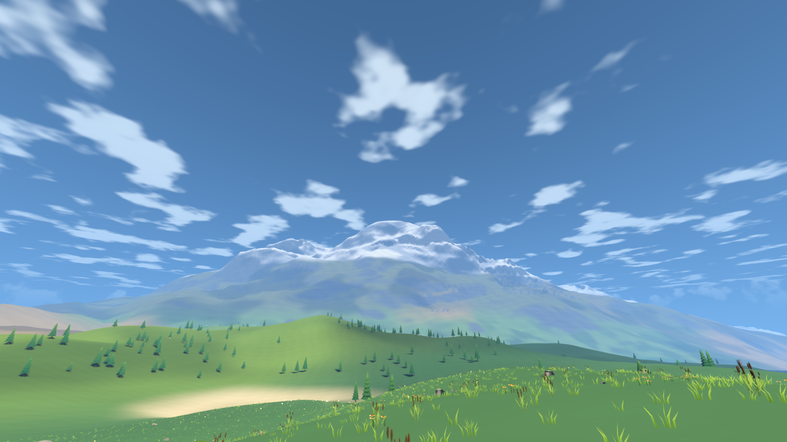

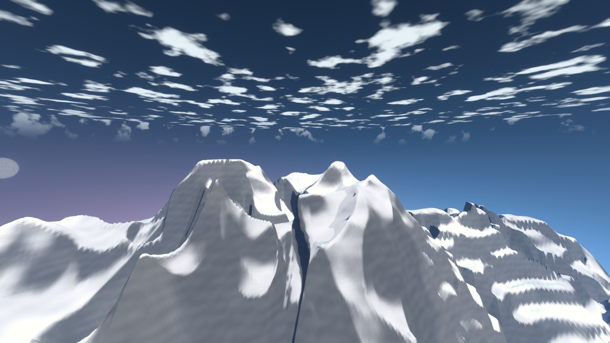

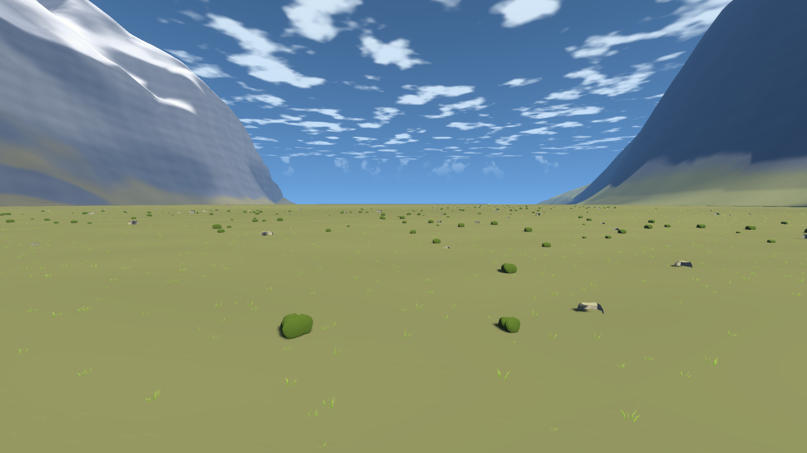

## Blender 四视图

每张从左至右为正面、侧面、背面和俯视。

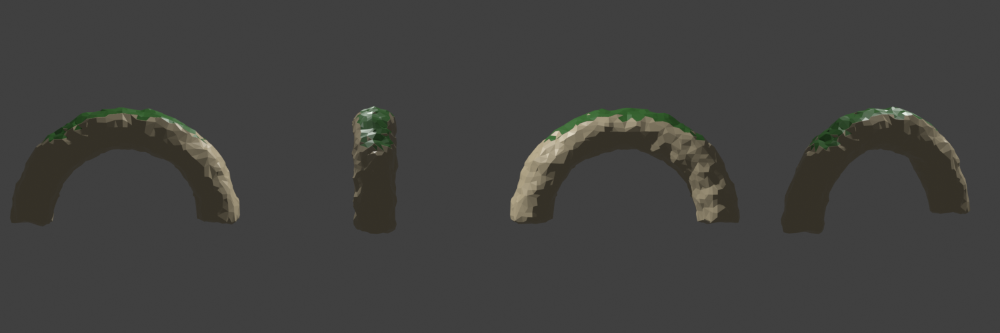
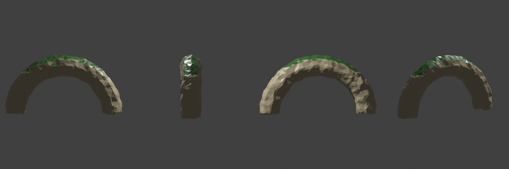
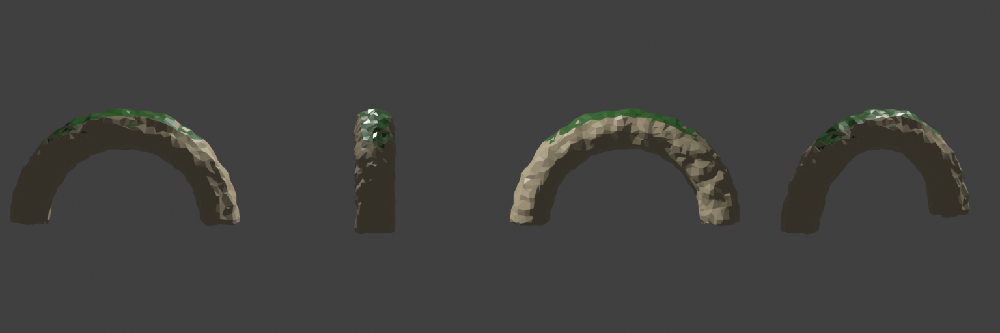
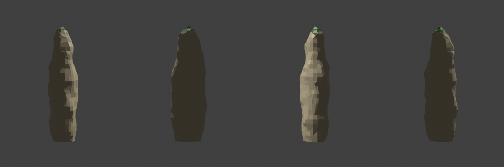
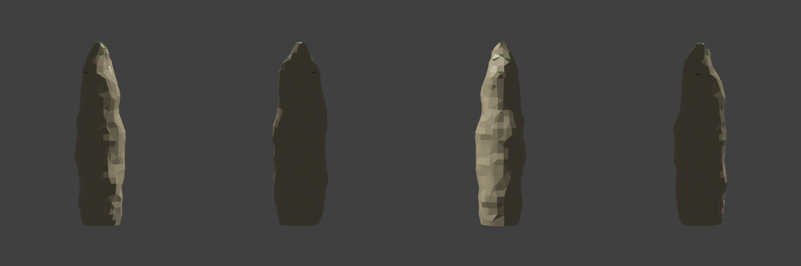
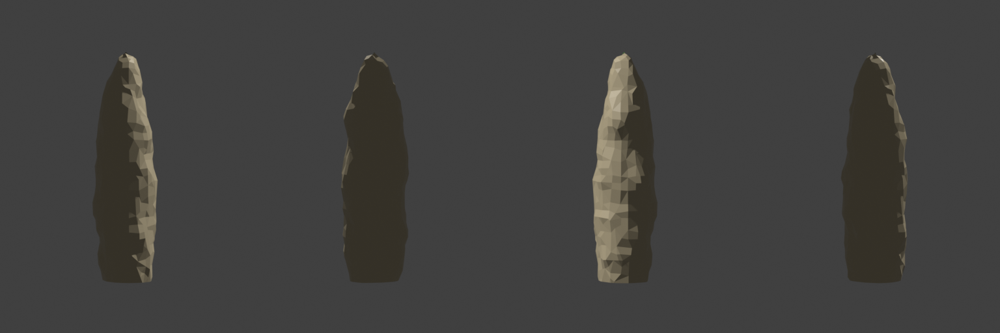
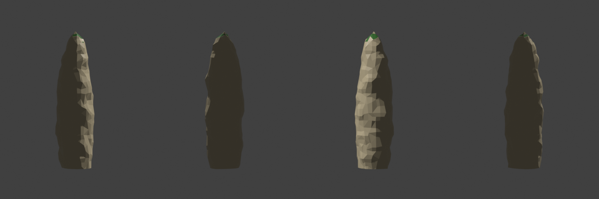
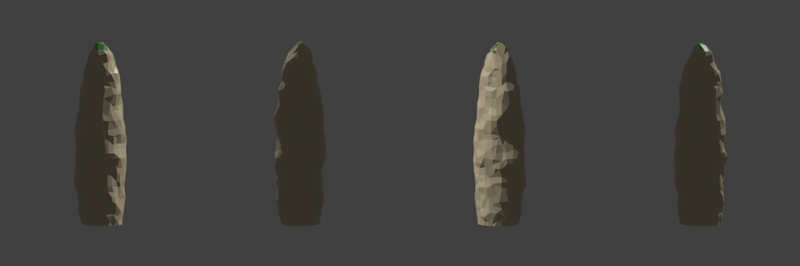
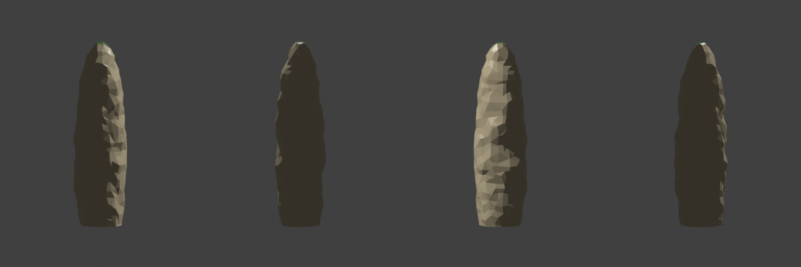
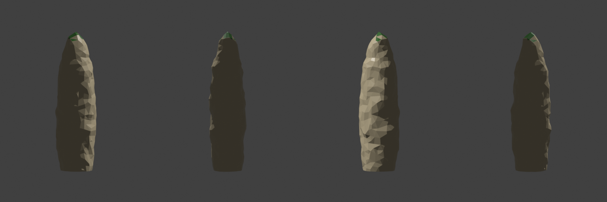
