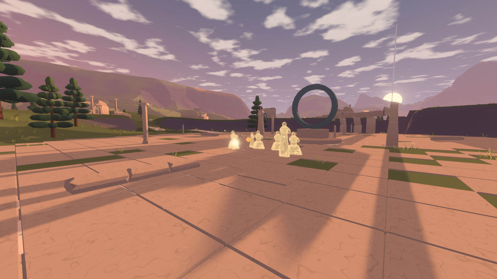
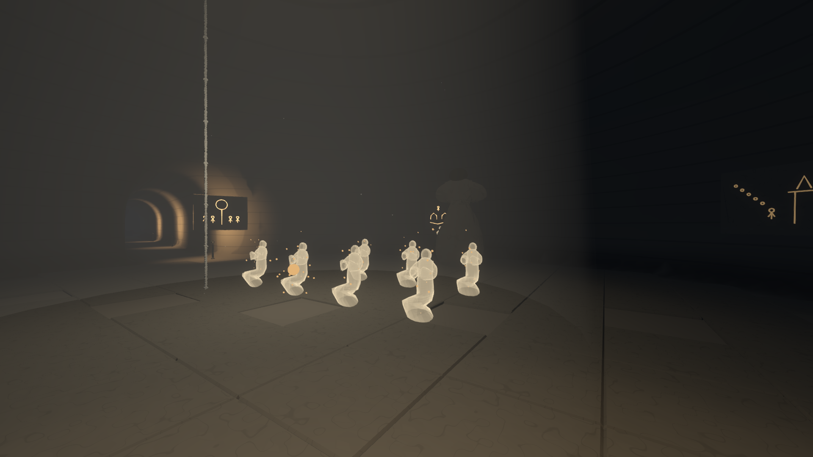
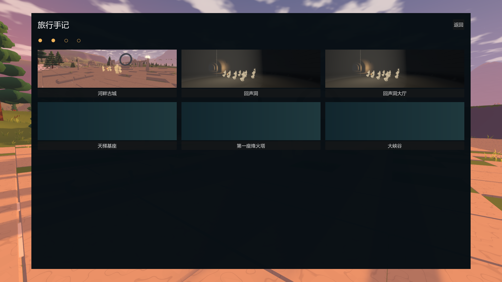
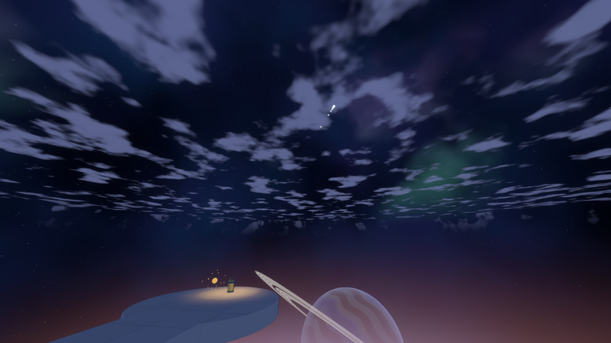

# 回声、手记与晨的结局：阶段交接

2026-10-22。第 11 步主体已实现，仍有未完成的验收和画面问题。用户因额度不足要求立即整理、提交推送并合并主分支；本次不宣称“第一版可玩”已完成。

## 已实现

- 成人、孩子沿用第 4b 步蒙皮模型，在 Blender 制作十种骨骼动作；另建细分布袋和曲线束绳组成的行囊。运行时播放、混合动作，不在脚本中摆动骨骼。
- 日常、信仰、离开、守望者四段回声，以及断口终章；琥珀透明人影、溶解、横纹、上升粒子和锚点提示。静止两秒触发，离开后返回静止三秒重看，提前离开用两秒淡出。
- 回声期间环境光、饱和度降低，风声降低八分贝；壁画逐块唤醒、天梯光环顺序回应、末塔添火。音乐入口预留，具体片段由第 12 步提供。
- 地点发现、名称提示、384×216 自动截图、暂停菜单手记、三列卡片、详情和地图定位；地图与地球仪添加琥珀地点及回声圆环。读取旧存档时补记已经点亮的烽火塔。
- 四段回声完成后唤醒断口，终章保留铜灯和四十个光点。沿路驾驶累计六十秒进入八秒星空过渡、两段字幕和三秒恢复。结尾期间禁止存档，暂停后继续仍保持驾驶控制保护，结局只播放一次。
- 存档新增可选 `discovered`、`echoes_seen`、`ending_seen`、`light_path`；先完整校验再修改世界。验证模式的自动保存不再写入默认旅程文件。

## 与规格的出入

- 洞穴回声半径扩大到十八米，覆盖距大厅中心约十五米的画师与壁画；普通回声仍使用八至十四米，终章触发半径六米。
- 为保留约二十五秒终章和缓慢步速，老人从圆台后方十七米的桥面走来，未从停泊台走完整段路线。
- 渊在天梯本站的地平线下。光之路保留其水平方位，将径向分量设为 0.65，避免路径穿入晨；末点海拔约 40398.57 米，即大气层外约 32.4 公里。方向仍按晨的局部坐标保存。
- 回声锚点由 `JournalSites` 根据现有文明数据计算，尚未写入离线 `CivilizationData`。没有修改已完成的地形烘焙和签名。
- 星空过渡使用与天空相同的星点函数在界面层绘制，并保留光路投影；没有逐个修改天体材质透明度。

## 已执行检查

| 检查 | 结果与依据 |
| --- | --- |
| `echo_checks` 最后无界面复查 | 通过。两套模型各十种动作齐全；真实广场站立触发、三秒重看、提前离开淡出、末塔门槛、四回声条件、光路计时和单次结局通过 |
| 新存档字段 | 十一种非法值全部拒绝，旧存档和往返通过；见 `echo_persistence_checks` |
| `ending_runtime_checks` | 通过。角色真实沿桥面行走 15.0664 米，在圆台静止触发；终点局部高度误差约 0.0039 米；四十光点、存档禁用、恢复驾驶及单次播放通过 |
| `ending_visual_checks` | 通过。真实渲染检查星空、游戏名、制作者、暂停菜单和返回；保存按钮禁用，暂停恢复后控制保护有效 |
| `completion_checks` | 通过。晨、烬、霜存档往返最大位置误差 0.000244 米；菜单、设置、塔链及升降台存档通过 |
| `ruin_kit_checks` | 通过，76 项构件检查 |
| `Check-Audio.py` | 通过，30 个不同的音频；本步新增 `discover.wav` |
| 回声额外绘制开销 | 十三人场景显示 9.3571 毫秒、隐藏 9.3324 毫秒，差 0.0247 毫秒，低于一毫秒预算。单次差值存在测量波动 |

详细原始报告在 `test-output/wanderer/`，主要日志前缀为 `11-`。本次普通步骤没有执行全套验收、重新打包、连续降落或连续行走。

## 机位与性能

780M、1920×1080、渲染比例 1、关闭垂直同步。取相应机位最近一次完整报告，不把失败结果改为通过。

| 机位 | 平均毫秒 | P95 毫秒 | 结论 |
| --- | ---: | ---: | --- |
| s46 广场回声 | 12.882 | 13.950 | 平均值超标；前一轮为 15.157 / 18.737 |
| s47 洞穴回声 | 9.450 | 10.741 | 帧时间通过；初始上传 6.097 毫秒仍超标 |
| s48 手记 | 13.452 | 14.853 | 平均值超标，背景仍绘制古城 |
| s61 光之路 | 6.172 | 7.760 | 通过 |
| s46b 主门回声 | 9.456 | 10.511 | 通过 |
| s46c 守望者 | 9.998 | 11.253 | 通过 |
| 受影响旧机位 s43 基座 | 8.970 | 10.640 | 帧时间通过 |
| 受影响旧机位 s42 夜间远景 | 9.159 | 10.509 | 通过 |

截图与已打开检查的 Blender 四视图集中在 `docs/images/wanderer/echoes/`。

## 自查判断和遗留问题

- 两轮外观自查已执行。修正了广场人影与纪念碑重叠、骨骼显示辅助体混入导出、动作贴地、队伍方向及过度重叠；行囊已补上。坐姿、跪姿的衣摆仍有明显折面，单膝与盘坐轮廓不够清楚，不能称为美术完成。
- 广场能够看见成人与孩子，主门队伍和守望者能够区分生活、离开、等待。信仰机位中的画师仍容易受到既有大雕像遮挡，画圆和直线的动作与壁画亮起尚未做到逐笔对应；目前按壁画序号推进亮度。
- 手记只展示已发现地点，不列未发现地点占位，也不显示收集数字。缺失截图使用纯色底是设计行为；详情点击、地图定位、所有地点触发范围仍需完整交互回归。
- 终章尚未把真实铜灯绑定到老人手上完成完整举灯、放灯动作；目前在相应时间建立留存铜灯。日常行囊放下后的位置、其他人跟随抬头、老人偶尔停步等表演细节尚待完善。
- 提前退出终章也会建立完整光路，以保证提前结束计为看过后的世界状态一致；尚需结合最终体验复查这一处理。
- 返回驾驶的截图中出现大面积强光，需在第一版主线回归中复查天空、朝向及亮度；不要把当前字幕检查通过等同于返回画面已完成。
- 自动截图隐藏 HUD，但并发暂停、读取存档时的截图队列和界面恢复尚未专门验证。早期验证曾调用默认自动保存，可能在本机默认旅程中留下验证状态；后续已经加入验证模式隔离，试玩前应核对默认旅程，保留原文件后再决定是否使用。
- 所有角色路径与真实地面、塔冠及建筑的逐点碰撞射线检查尚未完成；当前脚本检查只覆盖时间、锚点范围及部分实际行走，不能替代这一项。
- 最新粒子固定种子和机位暂停设置完成后，尚未重新生成全部回声机位；最后的三秒重看与提前淡出检查已经通过。不得继续重复完整验收来掩盖这些边界。

## 尚未执行的后续工作

1. 补齐上述第 11 步检查和功能缺项，再决定是否标记该步完成。
2. 第 12 步全部尚未实现：音频总线、混响、新环境声、`MusicDirector`、27 首来源曲目的分配转换、两遍响度归一、回声片段、来源清单和音乐检查。具体范围以规格 18 为准。原始音乐只用于个人游玩，不得标为 CC0。
3. “第一版可玩”全部尚未完成：`Test-Acceptance.ps1 -Scope all`、源代码及导出包检查、哈希核对、全机位比较、冷缓存降落、连续行走、完整主线脚本试玩、每段耗时、简短交付记录和最终打包。
4. 全套验收脚本目前遇到第一项失败会停止，尚需改为汇总失败后继续执行后续检查，仍保留总体失败状态。
5. 沿用前序记录中的性能和画面遗留：冷缓存降落超过五十毫秒、部分上传超过四毫秒、古城平均超标、观景环看不到古城、道路步行约四十五分钟、挡墙尖长变形、洞口与地图问题等。详见各步记录和进度表。

本次按用户最新要求将阶段代码合并进主分支，不表示通过工程约定要求的合并前 `-Scope all` 验收。第 9b 步及之后内容尚未开始。

## 2026-10-23：手记交互与截图状态恢复

- 修正截图等待绘制期间打开暂停菜单导致 HUD 原始可见状态丢失的问题；暂停时不保存菜单画面，读档时取消旧截图队列和已在等待的截图任务。
- 验证截图改存到独立目录，不覆盖实际游玩的手记图片。卡片图片也可点击打开详情，地图定位先放大，避免全图状态将纬度中心固定在赤道。
- `journal_checks` 在实际 Vulkan 渲染器中通过：十九个普通地点的范围内外检查、两张卡片与详情、地图定位、384×216 截图、截图期间暂停和读档、HUD 恢复及旧文件不被覆盖。
- 此次只检查上述受影响范围，没有重新执行完整回声验收和全套验收；人物表演、逐点接地和最后机位仍按前面的清单继续。

### 返回驾驶时的强光

光路的光点面片按观察距离保持屏幕大小。字幕返回时角色瞬间移动到末点前八十米，面片曾短暂保留原来远距离的尺寸；自查脚本暂停自动处理时，该错误会一直保留。已将朝向和尺寸更新独立出来，返回位置后立即同步，避免过期的大面片遮住画面。

`ending_visual_checks` 实际渲染通过，最近光点宽约 11.20 像素，暂停和恢复驾驶检查通过；已打开最终返回画面确认没有原先的大面积亮斑。此次只重测结局画面专项。
