# 天梯记录

2026-10-21，第 10 步。天梯的主体、升降台、观景环、断口平台与降落已经接入，终章回声与光之路留给第 11 步。

## 实现

天梯仍使用第 7 步选址：距出发地 14.75 公里，基准地面约 313.675 米。三层台地半径为 180、120、70 米，分别抬高 6、12、18 米，四个方向保留二十米宽台阶；高度、地形碰撞、地图与植被清理共同使用 `CivilizationTerrain`。

- 塔身从半径三十四米渐收至一公里高处的二十二米，延伸到约六千二百米；远景采用十六边形主体，环箍与光带在材质中表现。
- 近景在两千五百米内创建，包含三层残墙、柱廊、二十四米拱门、两尊放大的雕像、升降井与观景环；两个基座挡墙接入藤蔓攀爬。
- Blender 模型包括升降圆盘、观景环、断口环与停泊台、栈桥、主门、断口与五根缆索、守望者灯。环带由连续截面编辑，桥与停泊台由平面实体化，扶手、门楣刻纹和缆索使用贝塞尔曲线倒角。
- 升降台为 `AnimatableBody3D`，等待两秒，四十秒完成二百四十米行程，起止各三秒缓动；平台不在当前楼层时可在门口等待召回。铜框与门楣随等待和移动亮起，启动声与嗡鸣分别播放。
- 可选存档字段 `ladder_lift` 保存停靠端、目标端和行程时间；旧存档缺省为底层，近景卸载后仍保留状态，行程中读档继续移动。非法字段在改变任何世界状态前整份拒绝。
- 断口平台在塔身局部高度 6160 米，外半径四十四米、宽二十二米；停泊台三十六乘二十四米，栈桥四乘二十八米，尽头为八米圆台。高处朝上表面混合三成薄霜色，附近播放高空风声。
- `LandingPads` 保存星球局部坐标与朝上方向；低于三十米每秒、在停泊台上方四十米内时可降落，平台上可以召回飞船。飞行保护按塔身半径增加十五米净空，检查整段位移。
- 避开基座后末塔距天梯约 386.9 米；塔链仍保留九个存档编号。重新烘焙后检查塔基、通视、登塔和存档。

## 数值调整与出入

现有晨的半径为四十公里。第 7 步选址只检查六千二百米塔顶，实际逐百米采样发现，从出发地约能看到 2100 米以上、从古城约能看到 2300 米以上的部分。为保留古城、墓园与山口塔链的布局，本步将自动检查高度分别调整为 2200、2400 米；规格的 1500、1000 米没有达到。

远景环箍目前由材质条带表现，没有在轮廓上增加四米凸出。断口与缆索使用完整的低面数 Blender 模型，主体和断口共 648 个三角形；十个远景环带光点增加二十个，总计 668 个。六米环带在十五公里处不足一个像素，因此夜间使用受深度测试的柔边光点，近处仍看真实环带。

联动复查发现第 9a 步新增神殿道路横切古城台地，局部坡度超过站立上限；改为沿既有道路出城二百二十米后分岔。继续延长入口外实际行走检查，又发现洞门前十八米短台地形成陡坎，角色确实会停住，因此将其改为离线测量外侧山坡后建立的较长缓坡。道路的地形塑造目标与最终路面高度分别保存，最终路面高度重新读取唯一高度函数，保留洞口地形的后续叠加顺序。

## 检查

最终功能复测：升降台上下各一次，包含在观景环走出并返回，总计约 89.467 秒，移动期间站立比例为 100%；出口与返回位置都保持在约 240 米高度。断口平台上方三十米降落后飞船位置误差为零，下船站立通过；实际朝塔身飞行后向内速度归零，停在保护半径之外；离地五千米实际下落后召船，约 8.017 秒进入驾驶。

最终交互检查修正了两处真实碰撞问题：原连接板覆盖升降井，角色到顶前会撞到板底，现改为从圆盘前缘接到观景环；完整圆环不再保留首末重复端盖，实心圆盘改为共享中心的扇形面，避免接缝处产生重复碰撞面。出口检查同时断言二百四十米高度，防止掉到地面后仅凭 `is_on_floor()` 判为成功。

行程中存读档通过，位置误差 0.001953 米；旧存档缺省通过，八类非法行程状态全部拒绝且不改变角色、飞船与升降台状态。

本次存档改动后的完整菜单、设置、九个音频播放器、七个环境循环与三颗星球存档往返复查通过，星球位置最大误差 0.000244 米。

音频素材检查通过，当前二十九个文件。最终联动复查通过：全部道路最大坡度 0.726，路面记录与唯一高度函数误差约 0.0000143 米，2291 个基础最大高度误差 0.00854 米；九座烽火塔通视、实际登塔、点亮与存档通过。

修正入口后，主路线与回廊都从神殿道路最后八个采样点开始，实际走完全程分别为 178.4、120.7 秒，最大路径误差 1.156 米，没有卡住。洞穴为 53 块、231552 三角形、6508917 字节；本轮烘焙 197.488 秒。两面约六米的基座藤蔓墙分别用 4.5 秒完成攀爬并站稳，出口误差 0.082、0.328 米。

普通步骤未执行全星球验收、连续降落、连续行走或导出包。天梯完整功能检查与最终道路复查分开运行；只在道路调整后复查文明区、塔链和洞穴，没有重复执行已经通过的整套项目。

## 机位与性能

780M，1920×1080，渲染比例 1.0，关闭垂直同步。表中采用自查后的最终相关机位，未修改的机位保留首轮数据。

| 机位 | 平均帧间隔 ms | P95 ms | 最大地形上传 ms |
| --- | ---: | ---: | ---: |
| s41 出发地看天梯 | 9.760 | 11.302 | 3.960 |
| s42 夜间天梯 | 9.080 | 10.578 | 3.497 |
| s43 主门前仰望 | 8.251 | 9.411 | 2.908 |
| s44 观景环 | 7.669 | 8.636 | 1.550 |
| s45 太空看天梯 | 7.320 | 8.452 | 1.306 |
| s60 断口平台侧视 | 5.762 | 6.577 | 1.394 |
| s60b 停泊台俯瞰 | 7.066 | 8.546 | 1.568 |
| s37 神殿门复查 | 10.814 | 12.732 | 6.044 |
| s31 古城复查 | 13.561 | 15.488 | 4.955 |
| s36 塔链夜景复查 | 10.643 | 11.817 | 6.624 |

六个新机位与辅助俯瞰机位的帧时间通过。古城平均帧间隔仍超过 12.5 毫秒；神殿门、古城、塔链的初始地形上传仍超过四毫秒，保留到第一版整体验收。

s43 隔离天梯及基座绘制，首次增量为 1.799 毫秒。关闭基座墙体和台阶的阴影、保留塔身、柱子和雕像的阴影后，复测启用 8.038、隐藏 7.068 毫秒，增量 0.970 毫秒，通过一毫秒预算。

## 两轮画面自查

- 远处轮廓：s41 可以辨认细竖线，白天存在感偏弱；s42 修正后可辨认一串琥珀光点，不会遮住周围天空。还没有达到非常醒目的纪念物轮廓。
- 基座尺度：s43 中二十四米主门与约十四米雕像形成明确的大尺度；主体仍过于光滑，门框与塔身的衔接简单，峡谷岩层的重复色带也会分散注意力。
- 升降台：真实上下行与走出平台通过，地面状态稳定；观景环的视线仍被峡谷壁遮挡，s44 无法俯瞰古城。这项人工确认未达到目标，保留为选址与观景遗留，不把自动视线检查的较高目标当作观景成功。
- 断口：s60 显示护栏、栈桥和远处的渊，平台地面增加分缝；为同时看到栈桥，将固定相机改为环形平台上方十二米的侧视。s60b 则从停泊台实际眼高俯瞰，能看清海湾、山峰与大陆曲率，高空尺度成立。
- 模型：七份 Blender 四视图均已打开。主门、平台、灯的轮廓完整；断口外壳仍有规则的尖角，缆索偏细，薄霜与地砖较均匀。两轮后保留这些外观问题。
- 旧画面：s37 的洞外道路已连续接入洞底，没有入口漏天；古城挡墙的尖长变形和过于规律的排列在第 8 步截图中已经存在，s31、s36 仍能看见，未在本步扩大修订范围。
- 终章光点、飞向星海和字幕尚未接入，本步不评价结局节奏。升降声和高空风声已接入，最终听感仍交给第一版试听。

## 截图

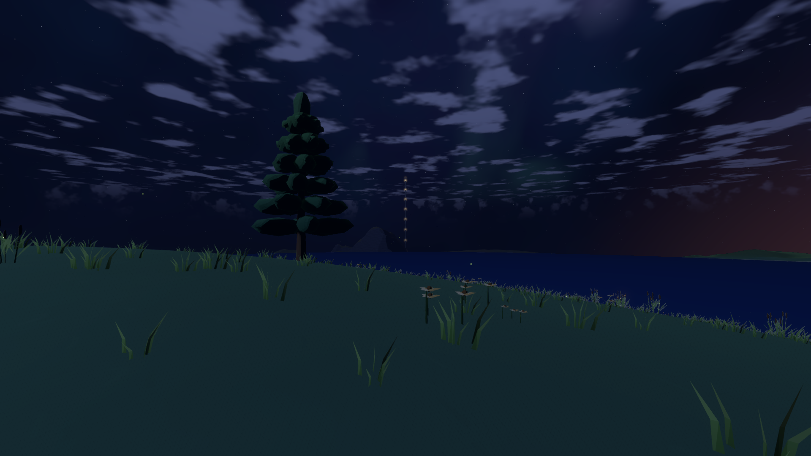
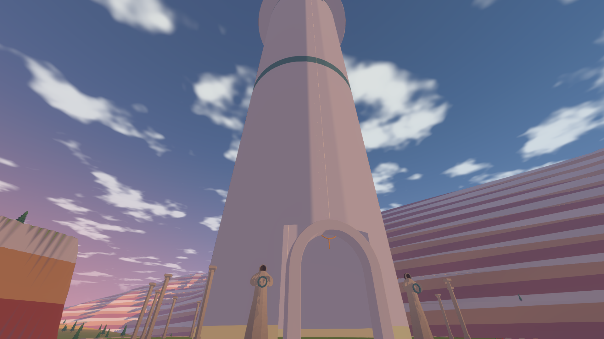
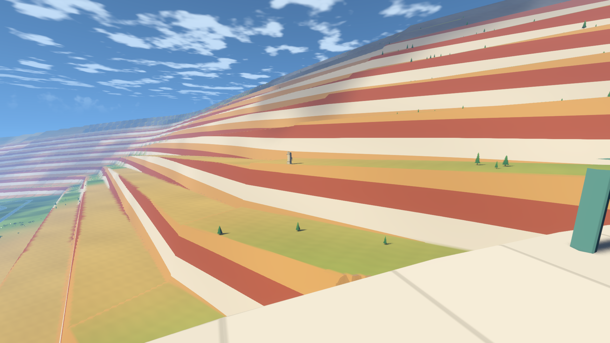
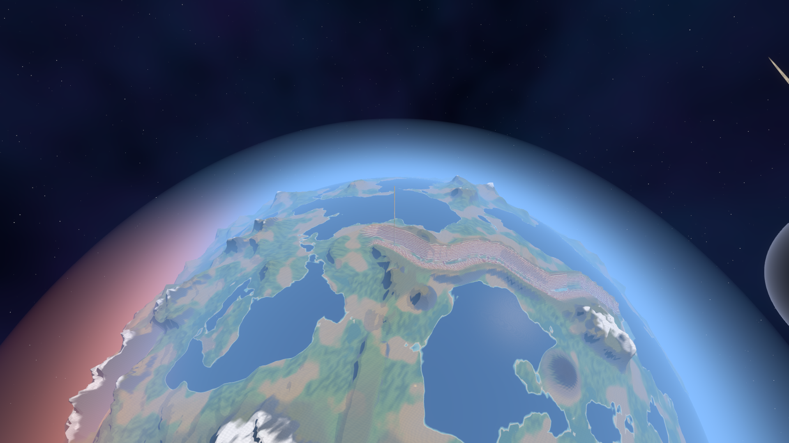
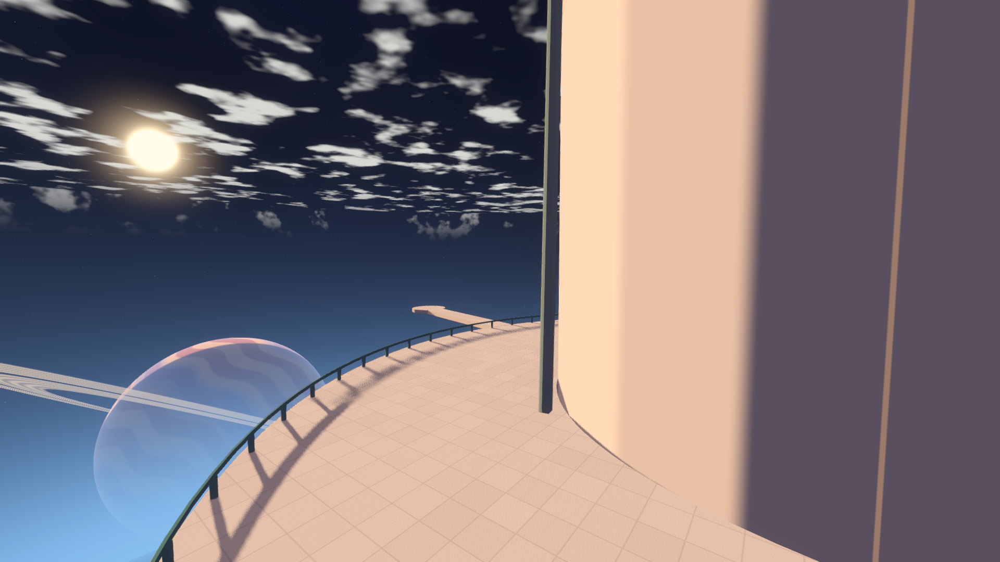
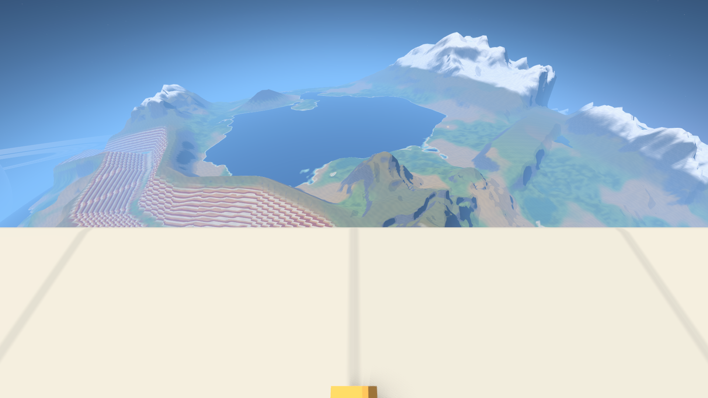
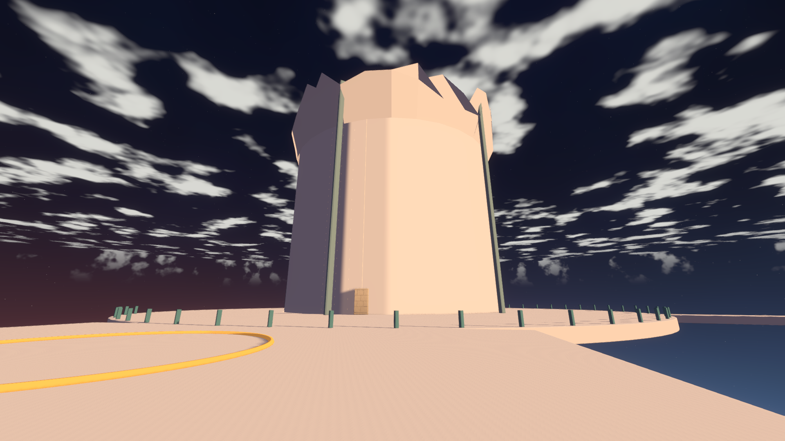
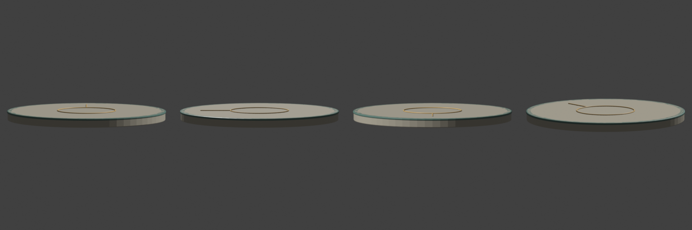
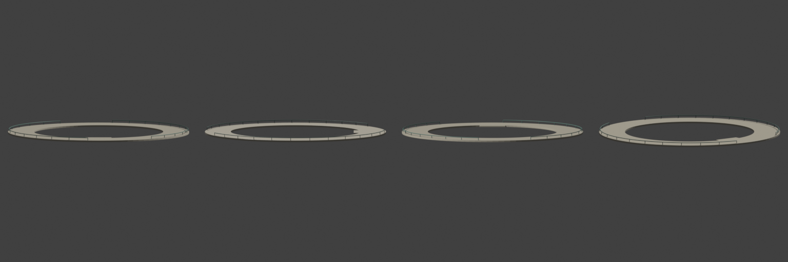
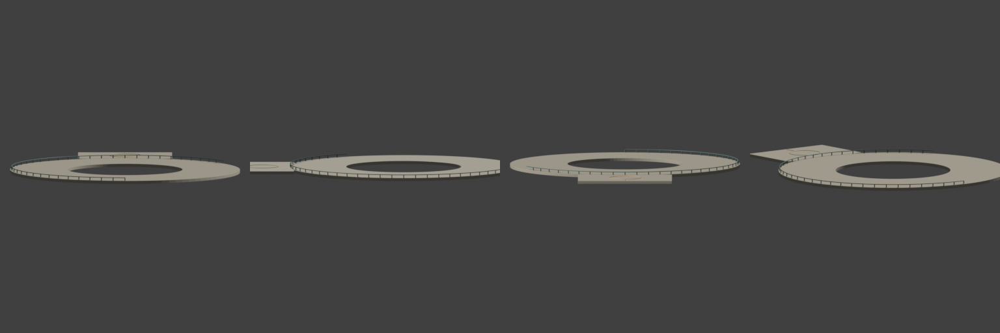
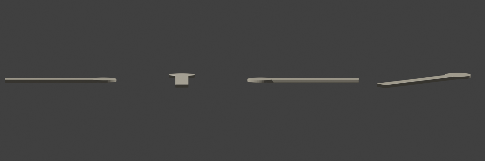
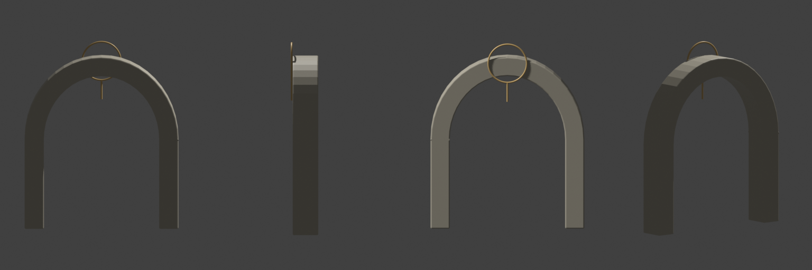
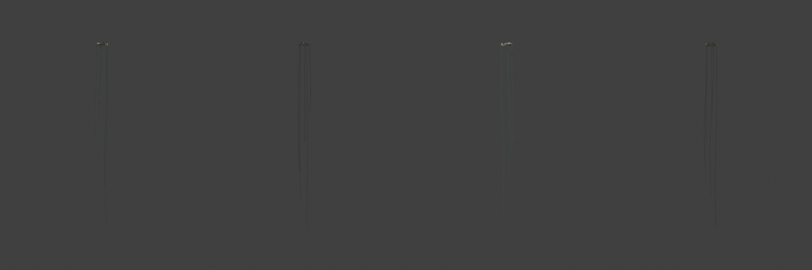
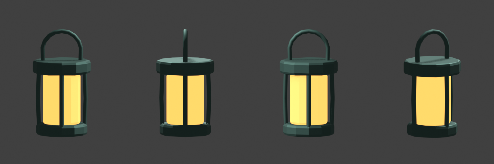
