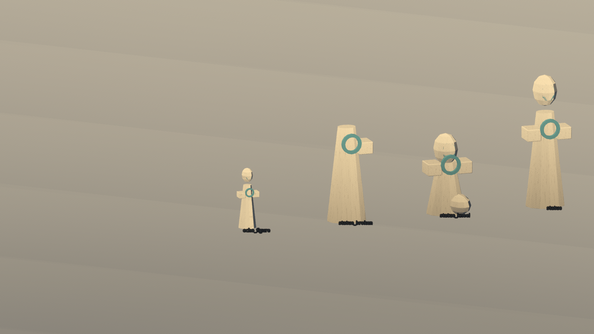
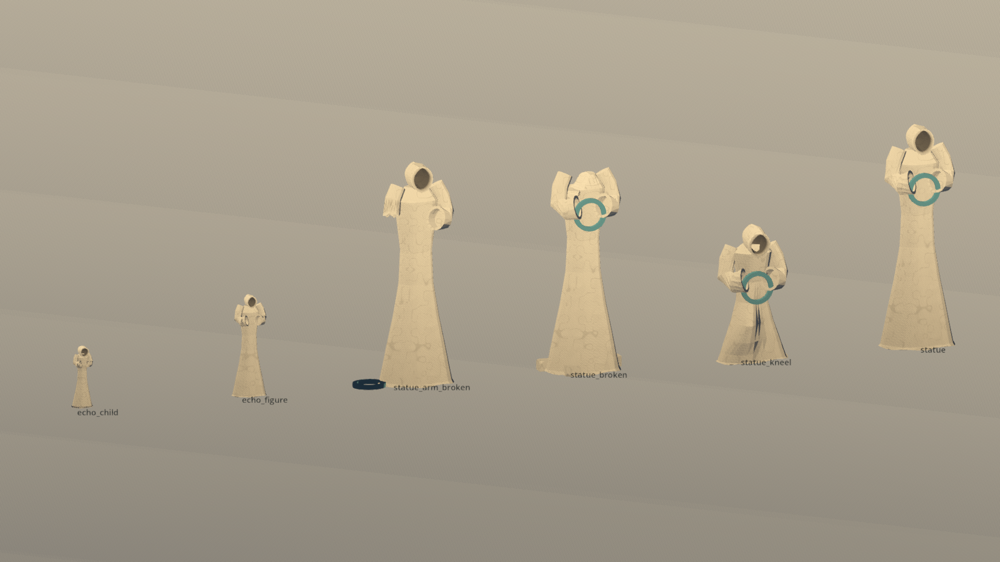
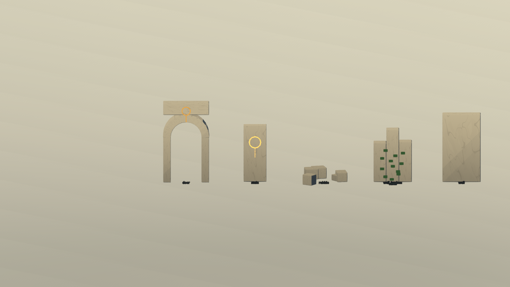
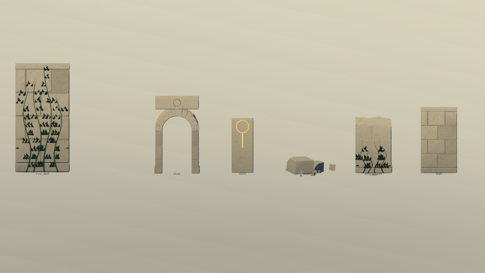
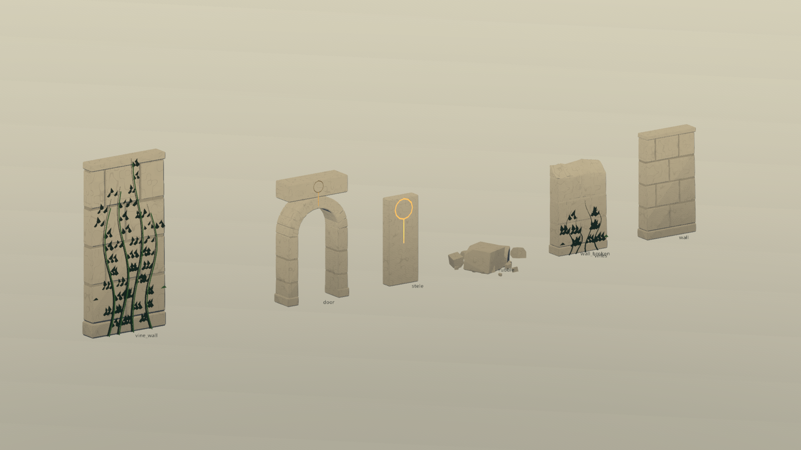
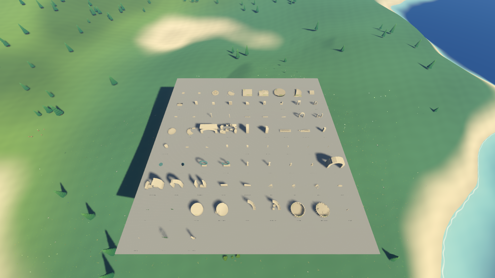

# 远行者构件修订记录

2026-10-20。对应[分步交接第 4 步](远行者/20-分步交接.md)和[规格 23](远行者/23-构件修订.md)。本步结束后等待用户确认风格，再进入第 5 步。

## 修订内容

- 人形改为连续截面的长袍、五道大褶、开口兜帽和弯折的宽袖。兜帽内部有深腔，使用石材和 0.15 的环境遮蔽，不再使用铜色面部。跪姿通过袍面表现抬起的膝部，并让兜帽低垂。
- 保留缺头的 `statue_broken`，新增缺臂的 `statue_arm_broken`，后者的小环落在脚边。新增 1.3 米高的 `echo_child`；它和 `echo_figure` 都包含 `Head`、`Robe`、`ArmLeft`、`ArmRight` 四个关节节点，原点分别位于颈、腰和肩。
- 残破件统一采用按名称派生种子的斜向切面，细分并扰动断口，脚边附带不规则碎块。细分只作用于断面及其邻接面。倒柱的三个断口也加入起伏。
- 墙、台基加入错缝、连续内芯、基座线脚与倒角，砌缝在内芯上形成约 1 厘米深的凹槽，直墙和窗墙外侧收分，完好墙增加压顶石。柱子增加约 3% 的卷杀、两级柱础和柱头顶板。
- 光纹统一由 `ring_and_path(position, normal, diameter)` 生成，在承载石材或铜件上刻槽，光纹放在低于原表面约 1.2 厘米的位置；残破部分移除对应光纹。
- 藤蔓改为连续主藤、侧藤和菱形叶簇，背面离墙约 1.5 厘米。新增 3 × 6 米的 `vine_wall`，粗藤凸出墙面约 10 厘米。展示机位为它提供背墙，正常游戏中尚未接入攀爬。
- 三种碎石各包含 2 块大石、4 块中石、10 块小石，以切角生成不同轮廓。大石增加几何倒角，大、中石使用简化凸包，小石没有碰撞。

共 75 个构件。生成入口仍为 `tools/Build-Models.ps1 -Target ruins`；几何算法拆分到 `art/blender/ruin_revision.py`。`RuinKit`、`RuinBuilder` 的接口和 `ruin.gdshader` 保持原状。

## 与规格的出入

以下调整遵守总览中“数值是起点，调整需记录”的约定，优先保留现有构件尺寸和通行空间：

| 项目 | 实际处理 | 原因 |
| --- | --- | --- |
| 广场铺装 | 环直径 3 米，径长 1.48 米、宽 0.3 米 | 直径 6 米的铺装容不下从半径 1.5 米处继续延伸 3.6 米的径；保持构件占地不变 |
| 门楣符号 | 环直径 0.4 米，径长 0.48 米 | 完整符号放进现有门楣，不侵入门洞 |
| 神殿门中央符号 | 环直径 0.65 米，径长 0.78 米；两侧各五个小符号保持直径 0.3 米 | 原定 1.6 米环连同径需要约 4.32 米的竖向石面，现有拱顶没有这么大的实心门楣 |
| 环形纪念物台座符号 | 环直径 0.35 米，径长 0.42 米 | 原定 0.8 米环连同径需要约 2.16 米高的承载面，台座只有 1 米高 |
| 藤蔓配色 | 沿用现有绿色布料材质，叶片朝向产生明暗变化，没有独立的黄叶颜色 | 现有着色器只提供一套绿色，按本步范围不修改着色器 |
| 小碎石倒角 | 几何倒角集中在大块，其他石块用切角保留不规则轮廓 | 兼顾至少 16 块石头和每堆 600 个三角形的预算 |

## 自动检查

`ruin_kit_checks` 已通过：75 个构件的两条路线尺寸和颜色一致，三角形、碰撞、原点、残破包围盒、断面细分、回声关节、门洞净空及砌缝深度检查均通过。最大构件是 `bridge_span_broken`，2033 个三角形，低于大件 4000 的预算。

| 构件 | 三角形数 | 预算 |
| --- | ---: | ---: |
| 站立／跪姿雕像 | 各 1600 | 5000 |
| 缺头／缺臂雕像 | 各 1672 | 5000 |
| `echo_figure`／`echo_child` | 1404／1491 | 3000 |
| 三种碎石 | 500／508／550 | 600 |
| `vines`／`vines_1` | 226／346 | 1200 |
| `vine_wall` | 1346 | 1800 |

`tools/Test-Acceptance.ps1 -Scope dawn` 的 41 项完整验收已通过，包括 8 项源码检查、5 项导出包检查、25 个固定机位，以及连续降落、行走和正常启动。全套报告是 `test-output/acceptance/summary.json`。本步全套检查按更新前的规则执行；提交前已更新并重读[工程约定第四节](远行者/02-工程约定.md)，后续按新版分级规则验收。

全套通过后，继续修正三项模型细节：碎石的确定旋转和贴地、缺臂雕像的落环位置、砌缝的连续内芯；同时补充可见网格的砌缝深度检查。游戏运行代码没有再修改。最终模型重新生成后，再检查重复生成、构件、导出包资源、构件总览、三个近景展示、正常启动和打包哈希。首包、首包完整报告及最终专项报告均位于 `test-output/wanderer/revision/`，文件分别是 `full-acceptance-StarSea.exe`、`full-acceptance.json` 和 `final-checks.json`，避免把不同包的报告混写成一次全套运行。

导出包资源检查读取 75 个构件、全球水系和飞船两条路线（各 3436 个三角形）。最终专项 `passed: true`，75 个构件、包内资源、总览性能、正常启动、重复生成和压缩包哈希均通过。最终可执行文件 SHA-256 为 `4a1dd5244b3f8b0b7149a7d7d518b3897f11e4cc29048a86127345921b97fb6e`。

重复生成检查通过。两次独立 Blender 进程生成的数据在固定三角形顺序后完全一致，最终 `geometry.json` 也与之逐字节一致，SHA-256 为 `c6c771fb80a6e3dec24dd2b34699e1f4f0f7716038d1b13a9a6790d2b24d9ec5`。报告为 `test-output/wanderer/revision/determinism.json`。

颜色检查除 RGBA 范围外，还按顶点位置比较 glb 与备用网格。导出时新建 UV 或颜色属性会改变 Blender 的属性布局，因此重新获取属性引用；备用颜色另存为独立数组，避免把坐标写进颜色。最终 glb 按导出后的顶点位置恢复颜色，容许导出与导入产生的微小坐标量化误差。

在 Radeon 780M、1920 × 1080、渲染比例 1.0、关闭垂直同步下：

| 机位 | 平均 ms | P95 ms |
| --- | ---: | ---: |
| `s29_ruin_kit`（构件总览） | 9.71 | 11.14 |
| `s29b_figures`（人形展示） | 6.19 | 7.28 |
| `s29c_details`（细节正面） | 6.19 | 7.32 |
| `s29c_details_side`（细节侧面） | 6.09 | 7.14 |

总览修订前平均 9.36 ms，本次最终包为 9.71 ms，增加 0.34 ms，低于新增系统 1 ms 的预算。总览满足平均 ≤ 12.5 ms、P95 ≤ 16 ms；近景三张用于风格确认，不新增正式性能验收机位。

## 展示与前后对比

修订前模型从提交 `1a41a43` 的归档中取得；使用与修订后相同的展示代码、机位和光照截图，没有修改图片中的构件。

| 修订前 | 修订后 |
| --- | --- |
|  |  |
|  |  |

侧面用于检查藤蔓和墙面之间的距离、砌缝及断口：

总览：

原始机位和 JSON 报告保存在 `test-output/wanderer/revision/before/`、`test-output/wanderer/revision/after/`；完整验收的导出包机位保存在 `test-output/acceptance/release/shots/`。近景展示使用正交投影，不列为新的性能验收机位；`s29_ruin_kit` 继续参与正式性能验收。

## 遗留问题与人工确认

自动检查只能确认几何和运行约束。以下事项等待用户查看展示图或本机试玩确认：

- 雕像是否足够修长，长袍、兜帽、袖子及跪姿是否仍有积木感。
- 残破断面是否自然，墙面是否有砌石感。
- 藤蔓是否像依附墙面生长，攀爬藤蔓的粗藤是否清楚。
- 调整后的符号尺寸是否符合预期。

尚未开始主山脉、大峡谷或后续步骤。
