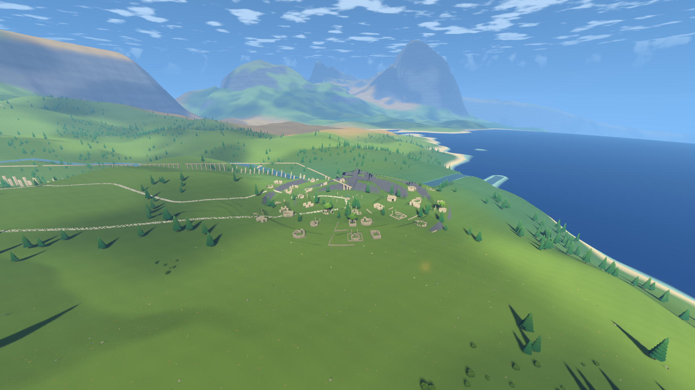
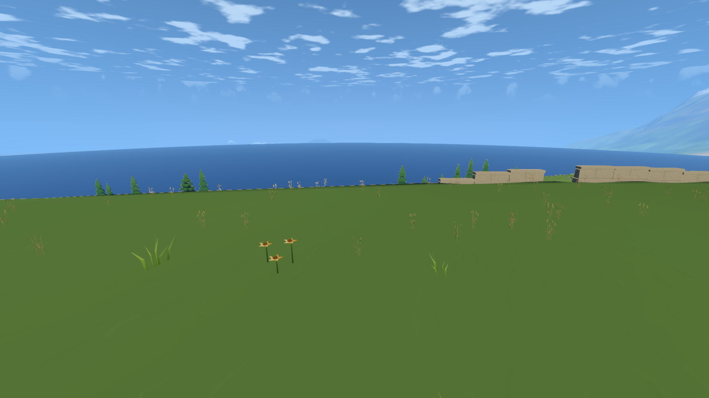
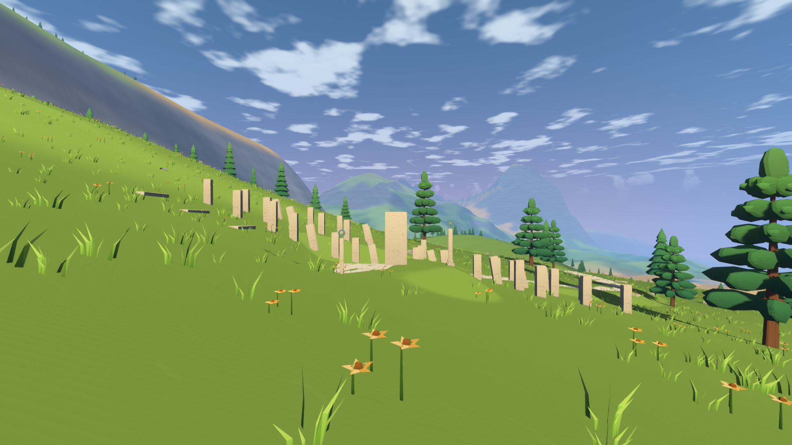
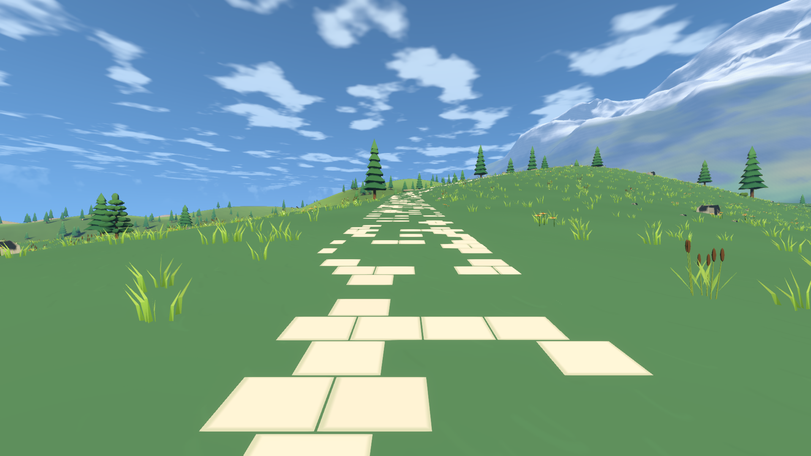
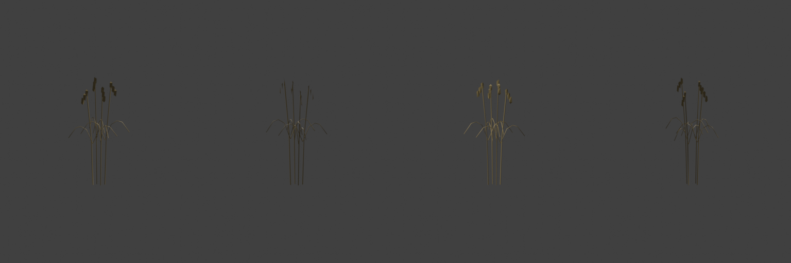
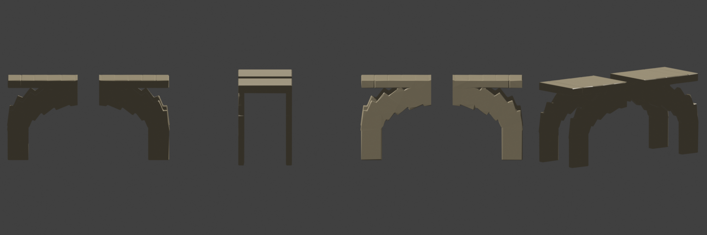

# 河畔古城记录

2026-10-21，第 7 步。晨的天梯选址、古城、道路、梯田、桥、水渠和墓园已经接入同一套离线文明数据。

## 实现与规格调整

- 天梯位于出发地 14.75 公里、相对远山方向 −118°，原地海拔 313.68 米。当前只有标明位置的细柱，第 10 步替换成完整天梯。视线检查确认能看到 1500 米以上的上部，考虑球面曲率。
- 严格的大河方案位于 12.029 公里外，古道寻路长达 29.205 公里且存在陡坡，无法作为步行主线。保留地形与水系，改选距出发地 6.588 公里的小河段：最低汇水面积由 40 调整为 10 平方公里，平均坡度上限由 0.12 调整为 0.18。河宽推算只作为汇水面积下界，不声称还原精确汇水面积。
- 古城离河中心 120 米，广场半径 32 米，高度 96.295 米；三圈扇区台地、三种房屋、残破屋顶、室内树木、纪念环、雕像、井和墓园均使用已有 Blender 构件。两处房屋藤蔓可以攀爬并翻到平台。
- 出发地古道长 10.833 公里，墓园道路长 1.954 公里。古道在距出发地 250 米的连续干燥位置消失，末段 800 米逐渐残缺。按普通步行 4 米/秒计算约 45 分钟，奔跑约 23 分钟，未达到普通步行二三十分钟的目标。
- 取水口沿同一河道上游 917 米；渠底从水位减 0.3 米下降至广场高度加 4 米。偏离原定减 1 米，是为避免岸坡压住第一段渠道。高处使用 29 道跨度 16 米的拱，缺段保持干渠状态。
- 路面采用独立贴地网格、石板着色器和一公里分块，不占用地形 CUSTOM0 B 通道。道路、房屋与广场缺板处分别控制植被。
- 稻秆由 Blender 贝塞尔曲线、叶片和籽粒建模后减面，312 个三角形，高 0.590 米；断口桥跨从原模型经过体素重构与布尔切割制作，1764 个三角形，保留同源备用几何与实际碰撞。

## 自动检查

报告位于 `test-output/wanderer/7/`，最终汇总见下表。普通步骤没有运行连续降落、连续行走、导出或三颗星球全套验收。

| 检查 | 结果 |
| --- | --- |
| civilization_checks | 通过；2151 个基础构件最大贴地误差 0.00842 米，954 个上层构件另计；无非桥梁基础压住河湖 |
| 道路高度与连续性 | 最大点间距 10.004 米，高度误差 0.000015 米，最大坡度 0.436 |
| 实际桥梁断口跳跃 | 通过；玩家尺寸、4 米/秒水平速度、5 米/秒起跳、9.8 米/秒²重力，落在对岸 |
| 古城两处攀爬 | 通过；每处约 3 秒，翻越后贴地，目标误差小于 0.004 米 |
| ruin_kit_checks | 76 个构件通过，包括新断口桥跨 |
| ecology_checks | 通过；真实稻秆模型与第二组 UV 风权重通过，六面几何与接缝检查通过 |
| ecology_runtime_checks | 出发地空地、树干与遗迹碰撞检查通过 |
| hydrology_checks | 通过；包围盒优化后高度查询 5.268 微秒，校验和 −1052952.55327；河流与湖泊统计保持不变 |

全部静态构件合计约 82.35 万三角形，按现有 MultiMesh 分组预计 286 批，不含地形、水面和运行时植被。曾尝试合并静态网格，实际绘制开销反而增加，已经撤回。文件空行规范化后再次完整烘焙，耗时 65.695 秒，资源大小 4,215,432 字节；高度算法没有变化。

## 画面与自查

模型四视图和最终机位保存在 `docs/images/wanderer/civilization/`。所有图片均实际打开检查。

| 自查项 | 判断与依据 |
| --- | --- |
| 古道能否吸引玩家 | s34 可看到石板从草地中断续出现，界石提供重复但非连续的提示；实际主线时间偏长，保留为遗留问题 |
| 古城是否有生活痕迹 | s30 的纪念环、井和雕像，与 s31 的三种房屋、三圈台地、河桥和水渠形成完整聚落；房屋残破程度有差异 |
| 路途是否单调 | 主线沿原有地貌绕行，古道只提供轻量引导，尚不能证明 45 分钟普通步行足够丰富；第一版主线复查 |
| 颜色、尺度、破面 | 稻秆改为褐金色，修正第二组 UV 的垂直翻转；桥面保持 1.75 米人物可通过的尺度；干渠拱顶与渠底按实际模型边界对齐 |
| 重复排列 | 台地挡墙、梯田墙与路面仍较规律；s32 台阶轮廓不够明确，s30 灯柱遮住部分纪念环，两轮自查后列为遗留；不把功能检查通过等同于美术完成 |

| 最终机位 | 平均帧间隔 ms | P95 ms | 最大地形上传 ms | 帧间隔达标 |
| --- | ---: | ---: | ---: | --- |
| s30_town_plaza | 14.71 | 16.21 | 5.66 | 否 |
| s31_town_overview | 12.12 | 13.22 | 4.02 | 是 |
| s32_terraces | 13.32 | 14.75 | 8.06 | 否，平均超出 |
| s33_cemetery | 11.42 | 12.62 | 6.25 | 是 |
| s34_old_road | 9.53 | 10.43 | 3.98 | 是 |
| s3_ground_day | 9.21 | 10.11 | 4.05 | 是 |
| s49_range_from_spawn | 8.72 | 9.58 | 6.46 | 是 |
| s29_ruin_kit | 9.83 | 10.61 | 1.43 | 是 |

另重截 s56b_boardwalk 展示图，确认全局石材背面剔除调整后，栈道、桥下平台与两侧藤蔓仍正常显示；展示图不作性能测量。

本轮机位测量整体未通过，失败报告未改写为成功。关闭垂直同步、1920×1080、渲染比例 1.0，240 帧采样；初始地形上传另列。

## 遗留问题

- 新系统最重机位 s30 隔离绘制检查：开启平均 14.331 毫秒，隐藏文明构件、路面、攀爬外形和稻秆后 11.104 毫秒，相差 3.227 毫秒，未达到增加不超过 1 毫秒的预算。该比较保留当前地形与清理区，不等同于完整旧提交基线；报告 `civilization_performance_checks.json` 保持 `passed=false`，第一版汇总。
- 部分机位初始地形上传超过 4 毫秒，沿用第 5、6 步的性能遗留；冷缓存降落的超过 50 毫秒停顿仍待第一版复查。
- 梯田挡墙、道路石板较整齐，古城外围挡墙尺度偏大；远处峡谷的三角形重复仍存在。
- 第 8 步补齐通往烽火塔的道路，第 9a 步补齐神殿洞穴道路；本步未提前实现这两条路。
