# 洞穴网络记录

2026-10-21，第 9a 步。当前只加入回声洞；暗河洞、青晶洞和小洞穴仍按总览留到第 9b 步。

## 实现

回声洞距河畔古城约 1850 米，保留神殿门、前厅、八十米柱廊、下降十五米的坡道、大厅、侧廊、壁龛厅、浅溪、第二出口和回廊。水平通道合计 830.37 米，另有一处天井绳索。大厅中央保留回声 2 锚点，第 11 步接入。

- 多网络资源保存图、入口、摆设、光源、攀爬和只读空间索引；模板最多在同一候选处尝试 32 个转向。当前拟合尝试 102 次。
- 胶囊、拱形通道和圆厅采用距离场并集，统一以半米格子离线提取 Surface Nets，按三十二米分块。全网采用同一种精度，避免开凿段与天然段交界出现异级接缝。
- 网格与碰撞来自相同的顶点和索引。洞口在地形渲染、地形碰撞中采用相同的开洞规则；入口外侧的小台地仍经过唯一高度函数。新增神殿道路后重新摆放地表构件。
- 每帧最多进行一次网格、碰撞片或摆设格子的创建。碰撞面离线保存，每片最多 256 个三角形，避免运行时调用整块网格的三角形树构建。
- 近处加载碰撞，远处只绘制洞壁；摆设按三十二米格子加载。光源仅启用最近十一盏，另保留探索者提灯；天井有昼夜变化的聚光灯、柔边光锥和浮尘。
- 提灯使用 Blender 曲线倒角和倒角旋转体制作；六幅壁画在既有石板上增加贝塞尔浅浮雕线，分别表现聚落、环与径、建塔、渊与船、登塔、守望者与光点。
- 地图用每十六米的探索节点逐段补全，未到达的岔路不显示。`caves_seen` 是版本 1 的可选字符串数组；旧存档缺省为空，非法值整份拒绝，洞内读档保留实际地下位置。
- 洞里关闭地表相机抬升，海拔显示为零，不能展开软翼、召唤或降落飞船；环境声改为岩石脚步、滴水和低风声。总线混响和正式音乐留给第 12 步。

## 与规格的出入

- 首个直接朝山内的方案会形成约 207 米深的天井，已拒绝。前厅之后沿山体侧方转向，最终天井绳索约 62.81 米；没有强行维持三十五米而挖穿顶板。
- 神殿门水平放大为两倍，以覆盖地形开洞边缘，净通道仍采用五米宽、六米高。塌方石堆缩小并移至通道侧边，保留实际通行间隙。
- 统一半米格子比天然段的 0.75 米起点更细，目前未额外简化平地面；分块、资源大小和帧时间另外测量。
- 第二出口位于附近的干燥山坡，浅溪没有接入规格要求的三至二十平方公里汇水河谷。这项选址偏差保留为遗留问题，不宣称已实现河谷水系连接。
- 侧廊与壁龛厅目前以灯座、石碑和洞壁表现，尚未形成完整的一圈凹入式壁龛；两轮自查后的具体外观问题在下方补记。

## 检查

普通步骤未运行连续降落、连续行走、导出包或三颗星球全套验收。

| 项目 | 结果 |
| --- | --- |
| 顶板与地面 | 已采样最薄顶板 13.073 米，最大通道坡度 0.1667，最低洞底海拔 290.426 米 |
| 连通 | 三个入口均可到达全部十三个主要节点，包含一个环路 |
| 接缝 | 6294 个共享单元，最大误差约 0.0153 毫米 |
| 入口 | 神殿门、天然出口、天井的中心均无残留地形三角形；十米外仍有完整地形；渲染与碰撞逐顶点一致 |
| 真实行走 | 两条路线均从门外七米进入；主路线包含壁龛厅往返后到第二出口，161.9 秒；回廊路线 103.4 秒，两条都没有卡住；最大中心线路径误差约 1.032 米 |
| 天井攀爬 | 实际攀爬 62.81 米绳索，49 秒后翻越到地表并站稳，出口位置误差 0.095 米；既有栈道攀爬复查通过 |
| 分帧创建 | 最终检查最高 0.990 毫秒；网格 0.666、碰撞片 0.870、摆设格子 0.687 毫秒 |
| 洞内限制 | 真实跳跃未展开软翼，脚下四米射线为空；相机仍在地下、海拔为零、召船拒绝 |
| 存档 | 洞内位置与探索节点往返通过；旧字段缺省通过；六类非法值整体拒绝，位置误差为零 |
| 音频 | 27 个素材检查通过，包含新增滴水和洞风 |

当前资源为 53 块、231384 个三角形；加入同源碰撞面后为 6509608 字节。最终整次烘焙 187.39 秒，洞穴阶段约 101 秒。最大六百米绘制范围可以覆盖整个回声洞，洞壁上界即上述三角形总数，摆设另计。

地形高度查询约 5.262 微秒，水系检查、出发地空地和原有地表碰撞复查通过；三颗星球的旧存档、菜单、设置和环境声检查通过。洞内规则与存档的报告分别保留在 `test-output/wanderer/9a/` 和 `test-output/wanderer/cave_checks.json`。

洞壁首次创建曾因运行时 `Mesh.get_faces()` 构建三角形树耗时约三十五毫秒，已改为离线保存同源碰撞面并分片创建。距离场的首个无穷大并集和远距离地板权重也已修正；洞口网格裁切到真实地表，开洞同时限制在实际空腔中，消除入口漏出天空和天井出口上方的封闭洞壁。

| 机位 | 平均帧间隔 ms | P95 ms | 最大地形上传 ms |
| --- | ---: | ---: | ---: |
| s37 神殿门 | 9.963 | 11.443 | 5.138 |
| s38 神殿大厅 | 9.657 | 10.835 | 5.672 |
| s3 出发地复查 | 9.773 | 11.359 | 7.652 |
| s31 古城复查 | 12.465 | 13.738 | 6.662 |

帧时间均通过；地形上传仍超过四毫秒预算。大厅同机位隔离绘制增量最初 1.104 毫秒，将六米尺度的洞壁噪声移至半米网格顶点计算后，复测为 0.941 毫秒（启用 9.556、隐藏 8.615 毫秒），通过一毫秒预算。

## 画面自查与遗留

新模型四视图已逐一打开：提灯轮廓完整，六块石板上的图案可以辨认；石板材质在游戏里使用统一遗迹材质。

自查两轮后的判断：

- s37 的入口能够看见内部地面，实际路线也能进入；门外光照正常。入口三角形边缘仍较粗，门的宽度与真实空腔不够协调，右侧残破雕像轮廓偏细。
- s38 中能辨认天井光束、巨像与壁画，地面可见，没有整片纯黑或漏面；巨像正面仍偏暗，光束较均匀，地砖排列过于规则。
- 进洞时环境光、天气和环境声在一秒半内变化，提灯逐渐亮起；这项状态变化通过运行时检查，实际听感仍须第一版试听确认。
- 两条路线都有完整实际行走记录；地图分段补全能区分已到达的通道与尚未探索的支路，大厅和回廊可作为方向参照。回廊较长，布局变化仍少。
- 本步竖井中，天井绳索可以通向地面；暗河和天坑不在 9a 范围，未评价。
- 大厅与通道仍偏暗，局部提灯足够辨路；当前光锥和灯光没有完成最终音画配合，不宣称已经达到最终演出效果。

洞穴地图能够显示已走过的路线，但大地图背景仍为压暗的全球地形，与局部洞穴图没有按同一比例定位；作为地图外观遗留保留。地表地图已增加实际发现入口的拱形符号。

截图与模型四视图见 `docs/images/wanderer/caves/`。第 5～8 步已有的地形上传超时、古城性能和外观遗留仍保留到第一版整体验收。

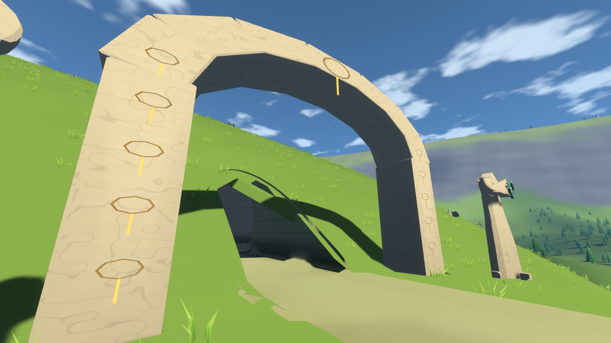
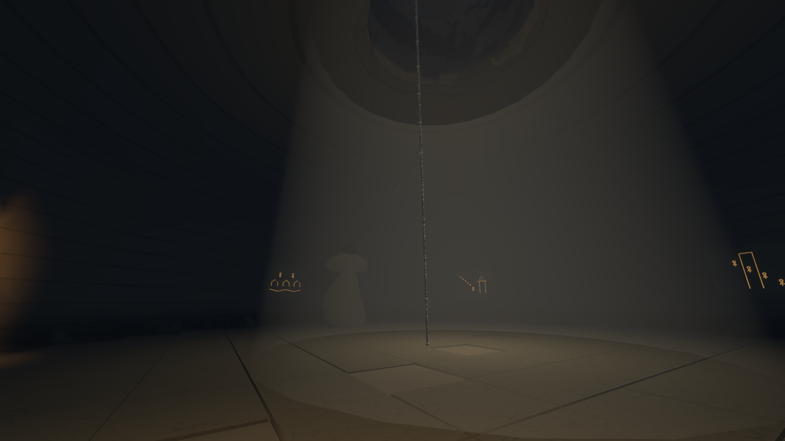
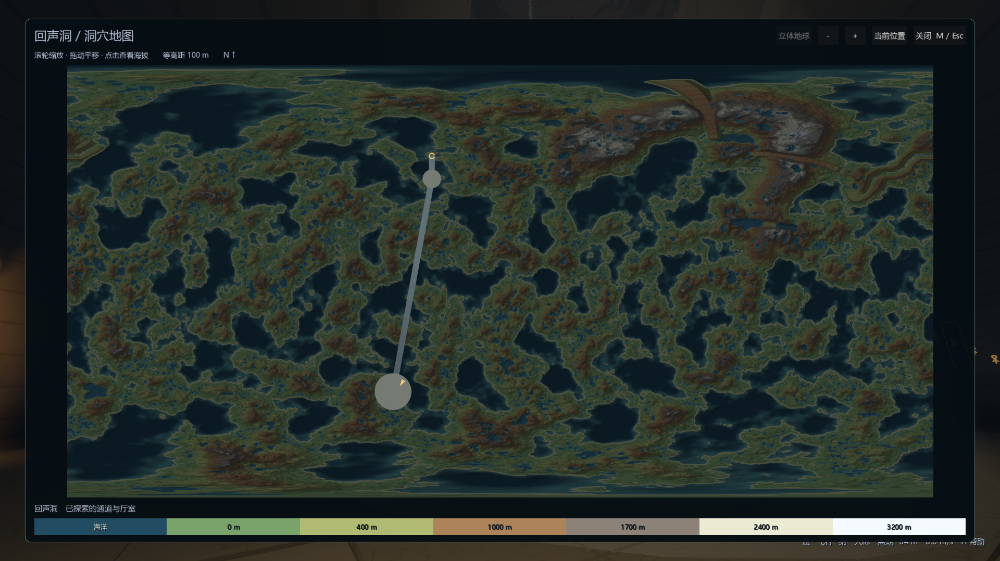
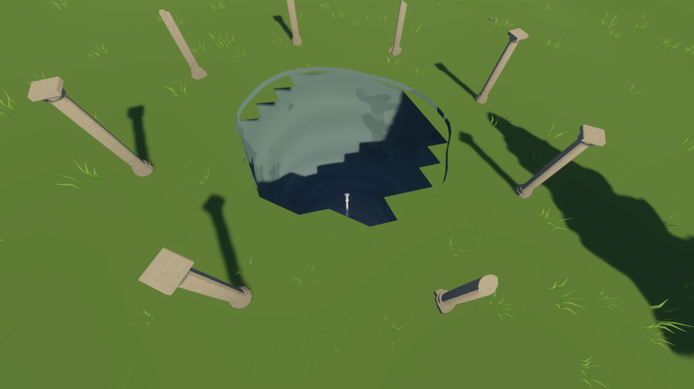
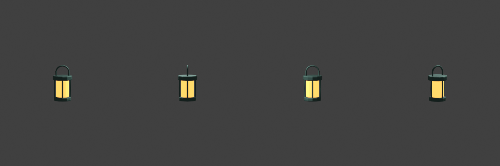
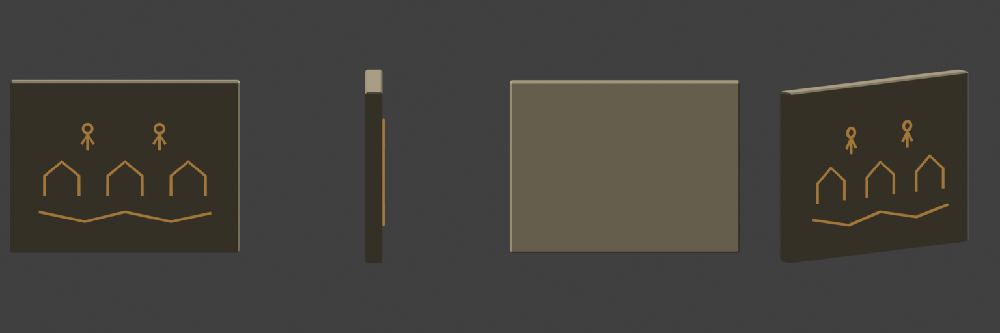
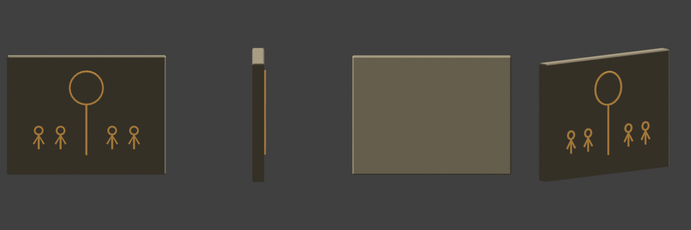
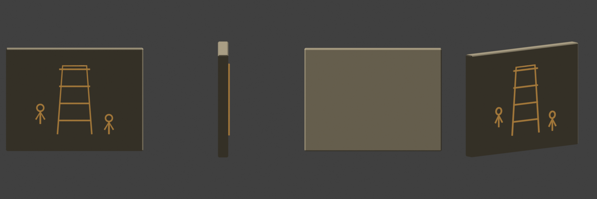
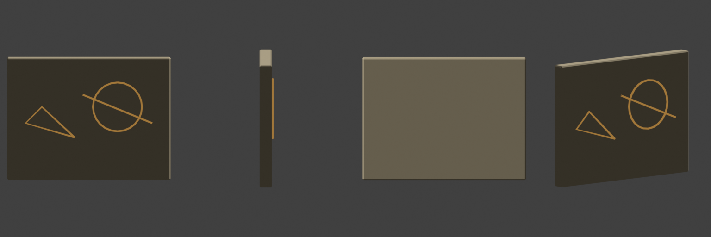
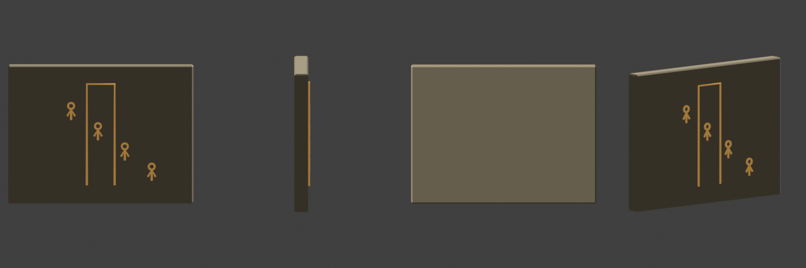
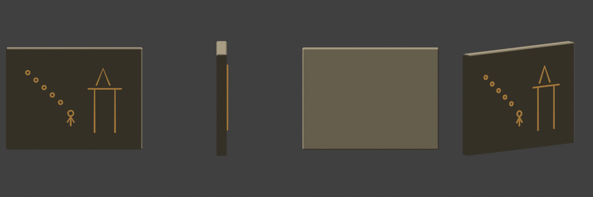
