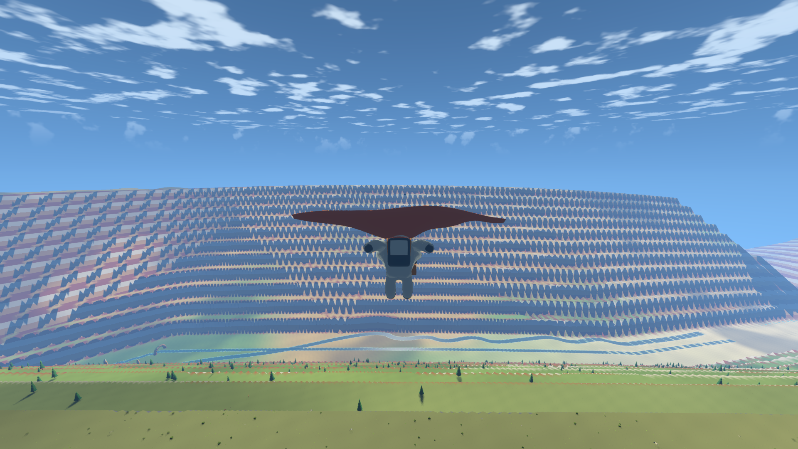
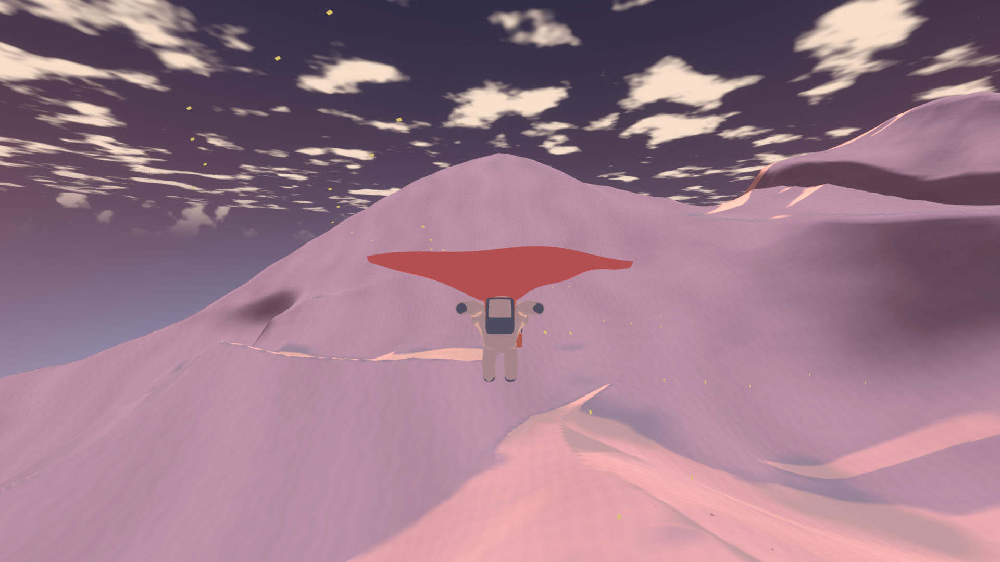
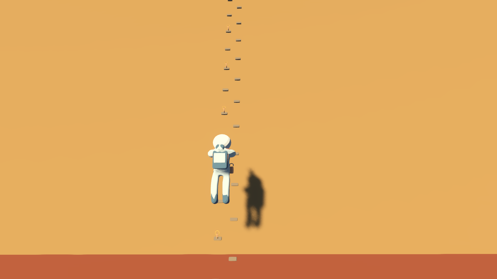
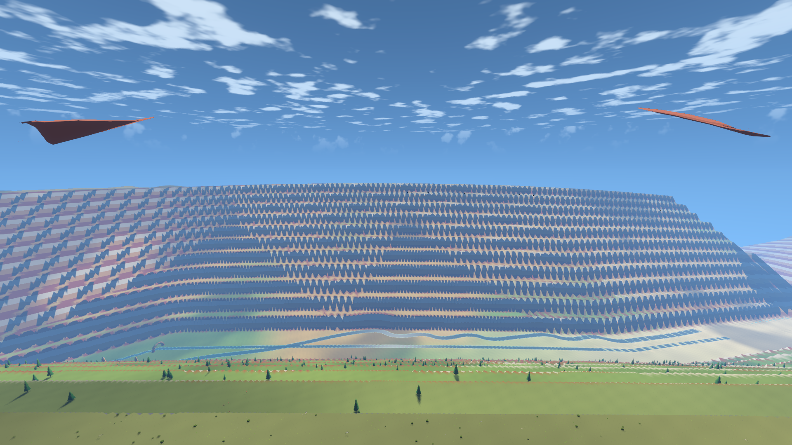
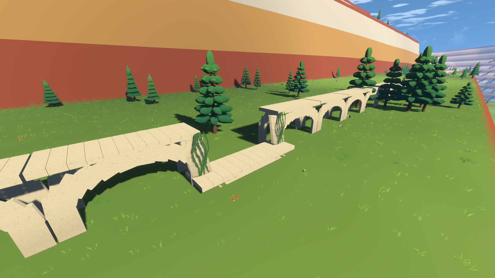
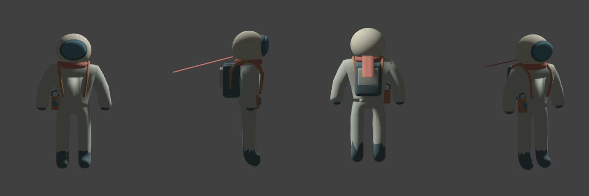
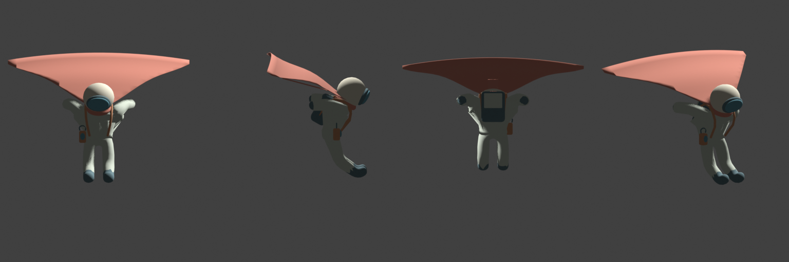
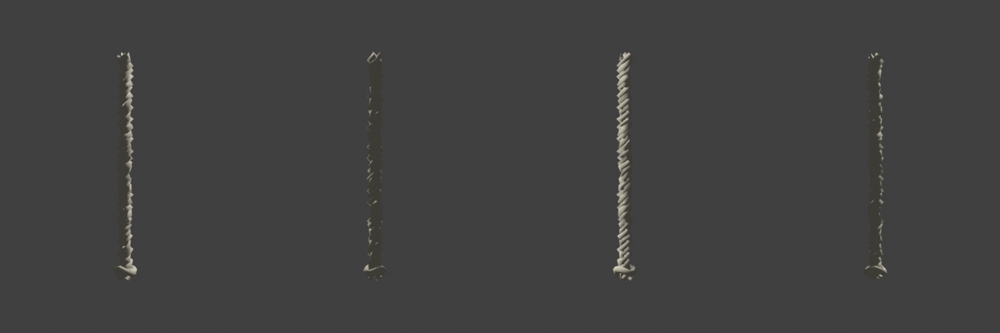
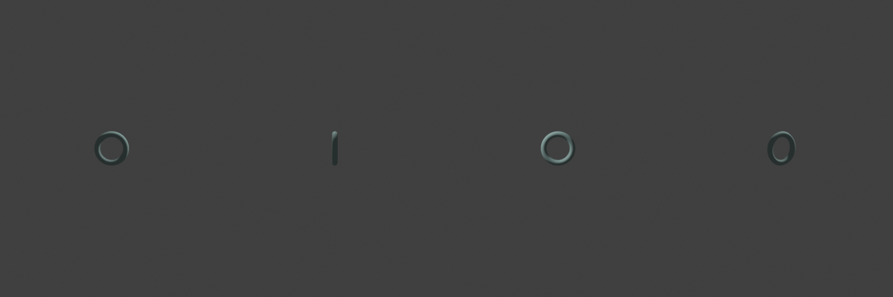
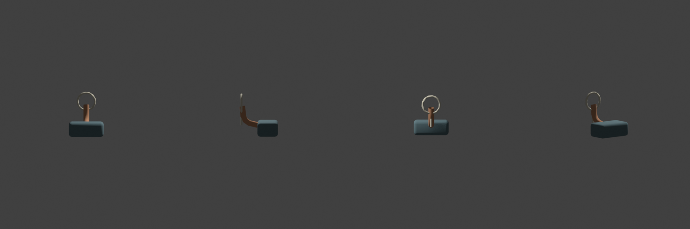

# 滑翔与攀爬记录

第 6 步。探索者改为 Blender 骨骼模型；增加软翼滑翔、上升气流、藤蔓墙、绳索、峡谷岩壁路线和空中召船。

## 实现与边界

探索者使用 Skin、细分曲面、实体化衣服、曲线附件和关键帧动画，7686 个三角形、27 根骨骼、10 个动作。围巾七节骨骼随风摆动，滑翔时切换为 2.6 米软翼。第一人称只显示两侧布边。绳索使用曲线生成，每 1.2 米一个模块和绳结，锚环只放在顶端；铜钉与脚窝使用 MultiMesh。

`PlayerTraversal` 管理运动状态，模式追加为 CLIMB=2、GLIDE=3，旧 WALK=0、FLY=1 保持不变。离地至少 0.35 秒且下方四米无碰撞才能展开，前进速度 9 米/秒、稳定下降 2.5 米/秒，转向限制 90 度/秒。山脊、峡谷边和火山口有随高度衰减的气流和附近光尘。

七个固定攀爬区写入布局：出发地遗迹藤蔓、山顶石塔绳索、三级峡谷岩壁，以及栈道断口两侧藤蔓。岩壁路线按真实曲面采样，接触时再用实际地形碰撞校正。两处休息台移到线路侧面，为头部留出净空。栈道修正了原先整体下沉六米的问题，桥墩从地面起立，下层桥和藤蔓形成绕行路线。

地面登船和召船要求 WALK 且实际站立；离地超过 300 米，长按 F 1.2 秒可请求空中接应。滑翔和攀爬存档仍写 WALK，保存最近一次经 `move_and_slide()` 确认的站立位置；读取模式 2、3 仍整份拒绝。设置新增可选的攀爬提示标志，旧设置默认未读。

洞穴检测按交接保留占位，专项第 8 条明确标记“未运行，依赖第 9a 步”，届时启用。尚未增加塔顶气流，随第 8 步接入。

## 专项检查

报告和原始日志位于 `test-output/wanderer/6/`，机器报告位于 `test-output/wanderer/`。

| 检查 | 实测结果 |
| --- | --- |
| 展开条件 | 平地起跳 0.2 秒拒绝展开；30 米高处离地 0.5 秒可以展开 |
| 无气流滑翔 | 从平坦碰撞测试区上方 300 米滑出 1022.30 米，113.9 秒落地，滑翔比 3.408:1 |
| 上升气流 | 20 秒内最高离地 51.80 米；离开后下降速度 2.5004 米/秒 |
| 直接坠落 | 200 米高处 6.2 秒落地；0.4 秒踉跄结束后恢复移动 |
| 遗迹藤蔓 | 3 秒攀爬并翻越，出口误差 0.050 米，实际站立 |
| 石塔绳索 | 58.17 米，45.5 秒，出口误差 0.051 米，实际站立 |
| 峡谷三级岩壁 | 曲线路程 152.54 米；各段出口误差 0.021、0.021、0.010 米，均实际站立 |
| 栈道绕行 | 两侧五米藤蔓均通过；连续下降、步行 13.60 米穿过下层桥、上攀至另一侧，最终出口误差 0.078 米且实际站立 |
| 存档 | 滑翔保存、恢复后地面位置误差为零；非法模式和设置整份拒绝，不部分修改 |
| 空中接应 | 从按住 F 到登船共 9.3 秒 |
| 飞船回归 | 两次存档往返、五种非法数据拒绝；地面召船 24.02 秒，危险水面和陡坡均拒绝 |
| 公共回归 | `completion_checks`、三颗星球 `surface_checks`、水系专项通过；24 个音频素材检查通过 |

另外模拟正常输入，在真实地形上从峡谷观景台上方 **35 米**出发滑行 2006.53 米，223 秒后接触侧壁收翼；该次没有站在地面。山口上方 **300 米**出发滑行 1165.51 米，129.5 秒后落地。两项均保留真实地形碰撞与分块生成，起飞高度已明确列出，不等同于从地面直接跳起的距离。

普通步骤没有执行完整验收、连续降落、连续行走和重新打包。第 5 步的降落性能失败仍然保留。

## 画面与性能自查

所有新增机位、第一人称布边以及 Blender 四视图均逐张打开检查。修正过围巾向上竖起、滑翔残留飞船遮挡、休息台挡头、栈道埋入地面等问题。

| 机位 | 平均帧间隔 ms | P95 ms | 最大地形上传 ms |
| --- | ---: | ---: | ---: |
| s54 峡谷滑翔 | 9.12 | 9.76 | 6.04 |
| s55 山脉滑翔 | 6.84 | 7.46 | 4.13 |
| s56 峡谷攀爬 | 9.57 | 10.67 | 5.20 |
| s14 第三人称 | 9.46 | 10.63 | 4.64 |
| s23 停放飞船 | 9.10 | 10.14 | 6.24 |
| s24 低空飞船 | 8.86 | 9.60 | 3.55 |

这些机位的平均帧间隔和 P95 均在预算内，但部分初始上传超过 4 毫秒，**不能称为全部性能通过**。s14、s23 相比第 5 步分别增加约 0.03、0.06 毫秒；新滑翔机位没有同位置的旧模型基线，不据此推算系统开销。栈道修复后只重新测量了受影响的 s54、s56，上表采用最终数字。布局重新烘焙用时 13.942 秒，水系数量和长度保持一致。

规格人工确认：

- 高处滑翔：峡谷和山口实测分别持续约 223、130 秒，下降速度温和；s54、s55 中地貌尺度和软翼都能辨认。
- 气流反馈：上升有光尘、叶片和风声，脱离区域后恢复下降；最高离地 51.8 米，没有无限上升。
- 攀爬操作：接近标记面按 W 自动附着，W/S 上下、空格跳离；真实碰撞检查覆盖顶端翻越与站立。脚窝和铜钉在 s56 可辨认。
- 步行价值：平地起跳无法展开，滑翔需要高处或气流，不能替代平地行走；当前实测 3.408:1，未进一步降低滑翔比。

两轮造型自查后仍有遗留：衣服和围巾部分折面明显，滑翔握姿靠近肩部，绳索近看仍较粗糙；峡谷远处岩层可见重复三角形轮廓。部分机位初始地形上传超预算，第 5 步冷缓存降落停顿也未解决，统一保留到第一版完整验收。听感和最终操作手感尚未经过用户试玩。

## 图像

Blender 四视图从左至右为正面、侧面、背面、斜视，另附滑翔展开姿态。

## 2026-10-24 收尾复查

峡谷岩壁改宽后，旧路线出口仍按此前地形保存。世界烘焙现会同步生成攀爬布局，并把该生成器纳入源签名；入口覆盖当前坡面，末段延伸到缓坡，原有高度约束没有降低。旧山顶石塔已经由烽火塔链替代，运行时停用对应的无实体绳索。

真实玩家复查十条路线全部通过；三级峡谷路线总长 168.247 米，出口最大误差 0.326 米。栈道下降、下层通行和上攀全部完成，终点误差 0.078 米。跳离后立即清除旧站立标志，并保留 0.2 秒向外速度，检查返回的向外速度为 3.036 米／秒。原始报告位于 `test-output/wanderer/climb_route_checks.json` 和 `test-output/wanderer/traversal_checks.json`。
