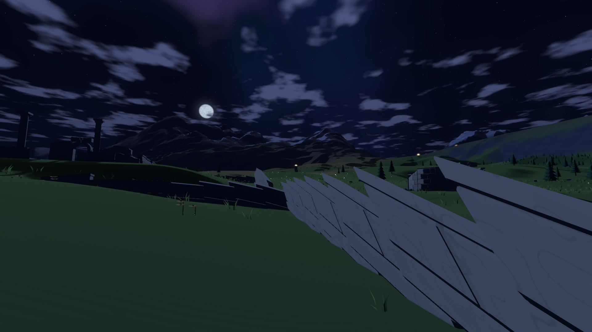
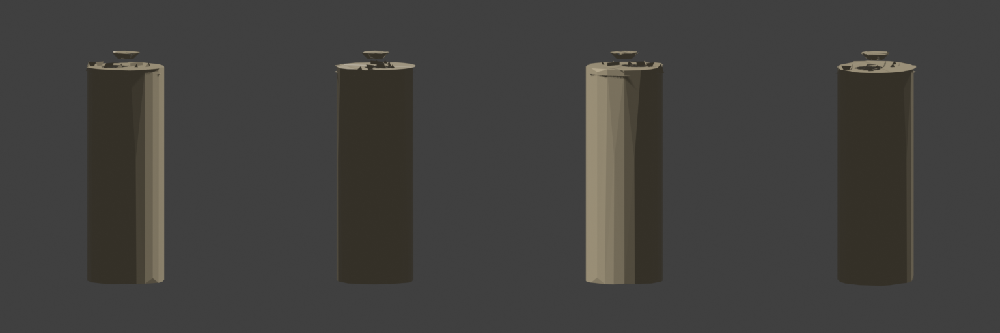

# 烽火塔链记录

2026-10-21，第 8 步。九座烽火塔把河畔古城、主山脉山口和天梯附近连接起来。

## 实现与规格调整

- 烘焙在 250 米候选格网上筛选：不在水中、距河道超过 100 米、坡度小于 0.6，且比一公里范围内的低处高至少 80 米。候选共 2782 个。
- 为保证经过山口，分别搜索古城后山到山口、山口到天梯附近两段候选图。采用 A* 回退搜索代替单次贪心选择，每段保持前进方向约束；所有最终相邻间距均在 2～5 公里内，没有使用 6 公里放宽值。通视沿连线每 50 米检查一次，使用球面坐标考虑曲率。
- 旧山顶石塔所在地坡度约 1.04，无法放置完整外挂石阶。新塔在同一山口附近移动 858.84 米，地面高 2266.66 米；旧石塔不再重复显示。
- 古城到首塔的道路长 852.64 米，全段采用 2 米山路，绕开已建房屋。补完道路后，在最终高度上重新摆放古城构件，避免新增填挖让旧基础悬空。
- 每座塔由六段塔身和六段旋转石阶组成，其中一段为残破变体。塔冠平台高 18 米；护墙缺口对准入口。塔冠水平缩放至 0.85，直径由 8 米调整为 6.8 米，仍比直径 6.4 米的塔身略宽，并为末圈石阶保留头部净空。断阶和平台入口分别需要一次短跳。
- 塔基七米内固定高度，七至十六米过渡；道路不能再次改变塔基。塔顶有上升气流，可以展开软翼滑翔。
- 两公里内绘制完整构件并生成实际碰撞；离开 2.3 公里释放，25 公里内保留远景轮廓。远景从 Blender 中的塔身、塔冠和火盆组合，经体素合并、减面导出，共 190 个三角形。远景不保留会形成细碎尖角的亚像素石阶。
- 玩家步行站稳在火盆三米内持续一秒后点亮；光纹三秒恢复，播放自制点火音，下一座两秒后开始回应。远景光斑保持深度测试、在大气之后绘制；白天亮度乘 0.35，回应周期四秒。柔边面片采用十六像素，以保留至少六像素的明亮核心。
- `beacons_lit` 为版本 1 存档中的可选字段。缺省为空，第一座回应；存在非法类型、重复编号、负数或越界编号时，整份存档拒绝读取。旅行手记和最后一座的回声锚点留给第 11 步。

## 检查结果

本步没有连续降落、连续行走、打包或三颗星球全套验收。公共存档改动单独检查三颗星球的往返。

| 检查 | 结果 |
| --- | --- |
| civilization_checks | 通过，含塔链、真实断阶跳跃、实际登顶、真实玩家站立点亮与延时回应 |
| 塔链通视 | 八段全部通过；间距分别为 4228、4126、4723、2346、4438、2650、3798、2382 米 |
| 塔基 | 九座塔六米采样圈与基准高度误差为 0 |
| 石阶实际通行 | 玩家同尺寸胶囊、3.5 米/秒移动、5 米/秒起跳、9.8 米/秒²重力；13.9 秒登顶，断口约 1.021 米，每 0.5 米中心线高度差 0.245 米 |
| 真实站立 | 脚底在平台上，塔内位置约 `(2,18.004,0)`；一秒触发、下一座回应通过 |
| 存档 | 往返、旧存档及七类非法值整体拒绝通过；三颗星球原有位置、朝向、模式和太阳往返也通过 |
| ecology_runtime_checks | 出发地空地、树干和遗迹碰撞通过；未把结果中的实例比较统计字段当成独立成功项 |
| hydrology_checks | 通过；高度查询约 4.646 微秒，水系统计与校验和保持不变 |
| Blender 模型 | 远景 190 个三角形，高约 19.15 米；最终四视图已打开检查 |

新系统隔离绘制检查通过：s36 当前场景平均 10.625 毫秒，隐藏塔系统后 10.167 毫秒，差值 0.458 毫秒；该测量保留当前地形和运行时更新，不等同于旧提交的整场景基线。音频素材检查通过，共 25 项。

最后一次完整烘焙耗时 84.205 秒，资源大小 4,223,136 字节。

新增了实际登塔与存档专项，避免只按参数推算“应该可通过”。等待地面的射线现在使用玩家实际碰撞掩码，读档到高处遗迹平台后也能恢复物理运动。

## 自查与画面

所有截图均已打开检查，放在 `docs/images/wanderer/beacons/`。

| 机位 | 平均 / P95，毫秒 | 最大地形上传，毫秒 |
| --- | --- | --- |
| s35 塔顶 | 10.635 / 11.866 | 5.272 |
| s36 古城夜景 | 11.118 / 12.186 | 7.056 |
| s31 古城全景 | 12.069 / 13.113 | 5.980 |
| s10 高地 | 6.608 / 7.740 | 1.625 |
| s3 出发地 | 8.930 / 9.925 | 4.917 |

这五个机位的帧时间通过；初始地形上传仍有超过四毫秒的结果，不能视为完整性能通过。夜景另检查实际图像：首塔暖色核心宽 10 像素，共 38 个明亮暖色像素；深度测试仍然启用。材质只对透明度做一次柔边衰减，避免重复相乘把光点压暗。

| 自查项 | 判断 |
| --- | --- |
| 从古城注意到微光 | 初次截图的纪念环和树木挡住首塔，已在古城边选择地面上的无遮挡位置，并同时检查地形、房屋和树冠；最终夜景可见三点塔光。实际光斑仍受深度遮挡，不穿透建筑和山体 |
| 登塔是否卡住 | 修正塔冠净空和入口后，实际碰撞通行通过；断阶与平台入口需要短跳，站稳后可以点亮 |
| 点亮时的表现 | 琥珀火焰、点火声、三秒光纹恢复与两秒后的下一座回应已经接入；听感和最终操作感在第一版由用户试玩确认 |
| 远景轮廓 | 保留竖直塔身、略宽的冠部和火盆；低面数远景丢失部分三足细节，近景仍使用完整构件 |

## 遗留问题

- 夜景前景残破屋顶仍有细长尖片，古城的规则排列和峡谷三角形外观仍需打磨。两轮画面自查后保留，不在本步扩大修改范围。
- 第 7 步古城重机位和初始地形上传超时仍保留，第一版一起复查，不将其改写成成功。
- 远景火盆三足在极低面数下不够完整，塔冠入口需要额外短跳；两轮自查后记录保留。
- 目前只存点亮编号，第 11 步补记为手记发现并接入最后一座的回声。
