# 画面打磨记录

第 25 步的五项画面修改已完成。整体验收与交付结果见[第一版记录](远行者第一版记录.md)，所有机位数值见[性能对照](远行者第一版性能对照.md)；未通过的预算不计作通过。

## 峡谷

保留十一层大台阶，陡壁水平展开约四十五米；近处峡谷网格间距控制在八米以内，消除远景采样形成的密集三角形。石材采用浅赭、暖灰、淡红褐的线性空间配色，色带宽度不一，增加纵向风化纹理。谷底与冰川使用原有配色。

大河无合格古城河岸时进入原有小河选址方案，没有降低选址阈值。最后一次统一烘焙耗时 166.110 秒，水系资源 4,218,742 字节。

| 修改前 | 修改后 |
| --- | --- |
| 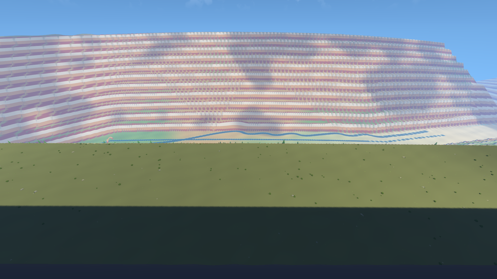 | 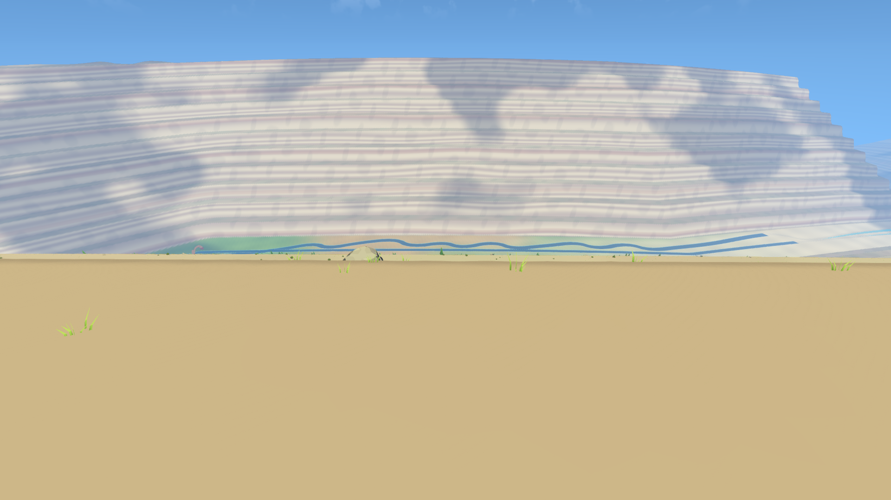 |
| 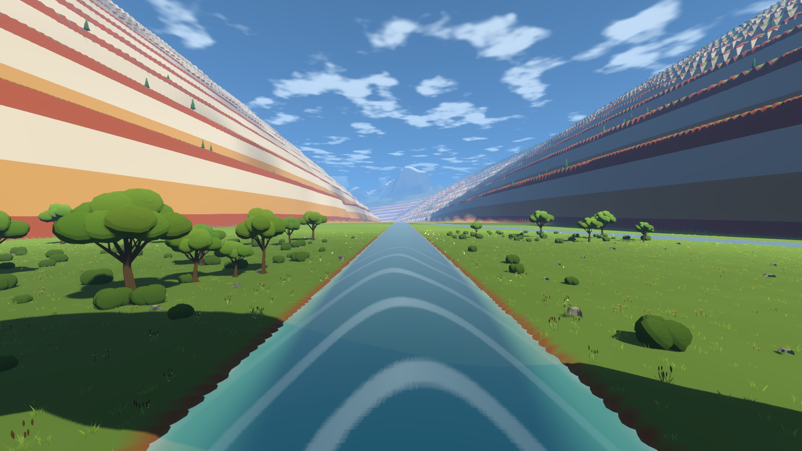 | 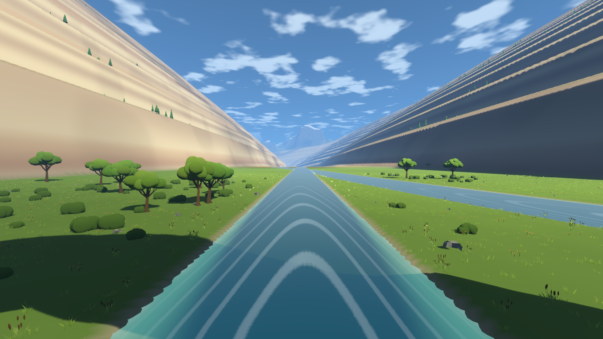 |
|  | 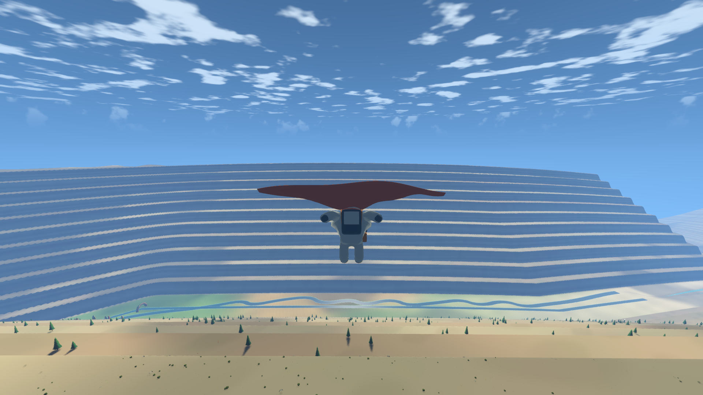 |

## 天梯

塔基半径六十米，一公里以上三十八米。平台、栈桥、停泊点、飞行保护与回声位置同步调整。底部三百米增加石肋、横带、扶壁、三层退进的主门与铜边；门楣环与径直径八米，巨像高台、灯柱与残旗按三层台地落地。

2026-10-24 用户确认取消七百米上限，允许观景环约二千四百五十米、单程不超过七十五秒。最终烘焙高度 2455 米，升降台七十五秒包含起步与减速。已经完成真实上下行和观景环走出、返回：站立比例 100%，两次行程与停留合计 159.283 秒。掠塔保护的测试高度改至五百米，避免低空先碰到地形；针对性检查通过，最终专项复查上下行站立比例 100%，行程与停留合计 159.233 秒，观景环走出与返回均通过。

移动平台接触修正涉及公共玩家代码：站立时不保留上一帧平台竖直速度，静止时仍施加重力；井内使用平台轴向。浮动原点只延后正常阈值附近的乘坐行程，远距离读档仍立即归零。最终全套检查暴露升降台额外物理同步会写回原点平移前的全局变换；平台本就在物理帧更新，关闭这次重复同步后，实际上下行、断口降落、整段终章步行与片尾专项全部通过。

观景环与古城相距约十一公里。相机方向和一米间隔的几何视线检查均正确，最小净空约 2.1 米；远景保留同源建筑轮廓，避免近景卸载后古城消失。建筑投影范围约 42×9 像素，最终 s44 与真实外缘照片都只能辨认很小的浅色轮廓，仍达不到清晰俯瞰整座古城的效果。

| 修改前 | 修改后 |
| --- | --- |
| 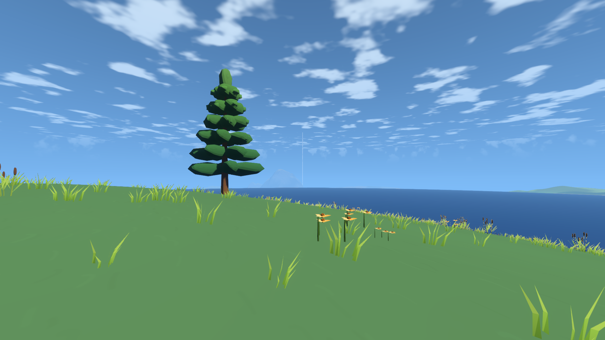 | 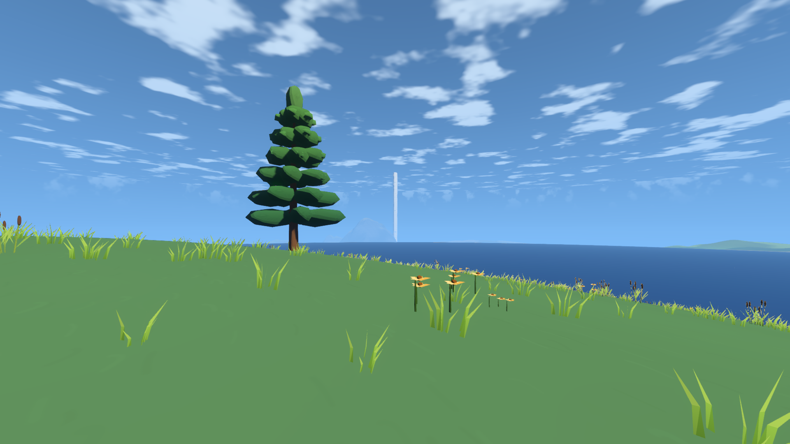 |
|  | 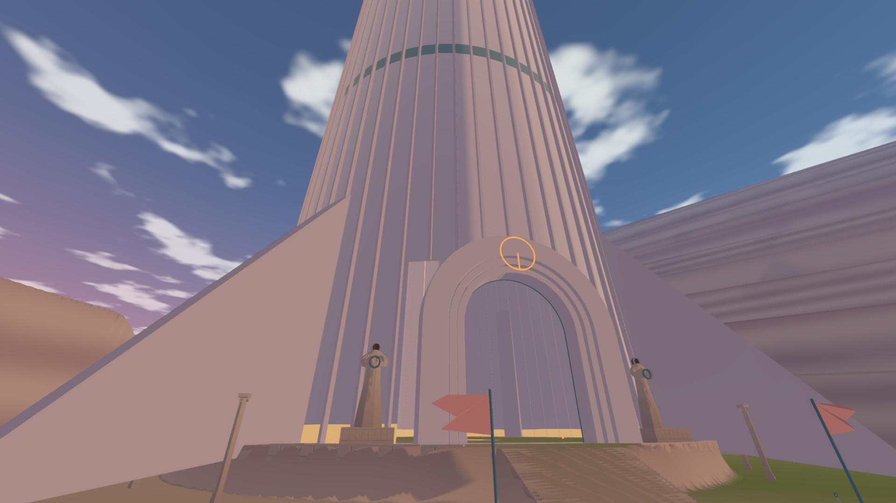 |
|  | 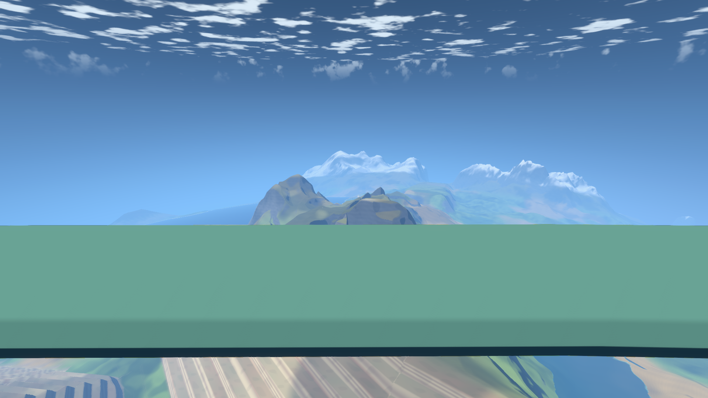 |

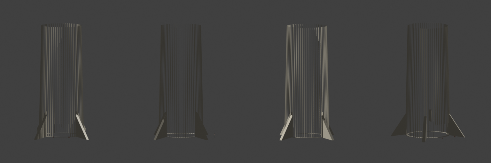
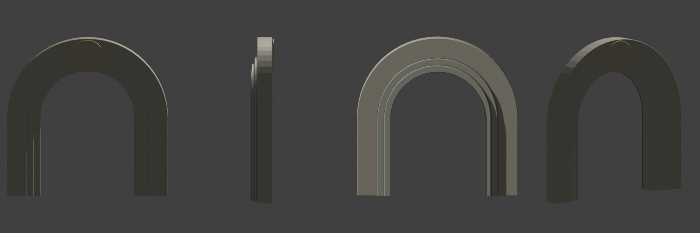
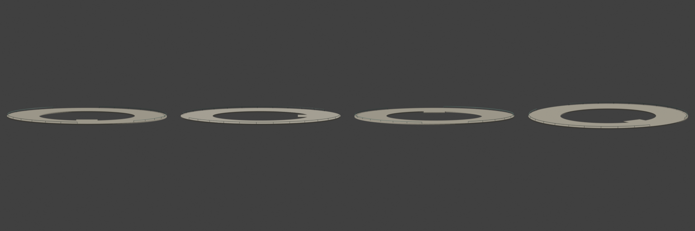

## 古城广场

广场半径由三十二米缩至二十二米，第一圈房屋向内靠近。中央只保留一个五米环形纪念物。铺地边缘逐渐残缺，草沿窄缝生长；少量石板倾斜或缺失，倒柱、碎石、石碑、树与积土错开放置，一侧保留矮墙和台阶。

| 修改前 | 修改后 |
| --- | --- |
| 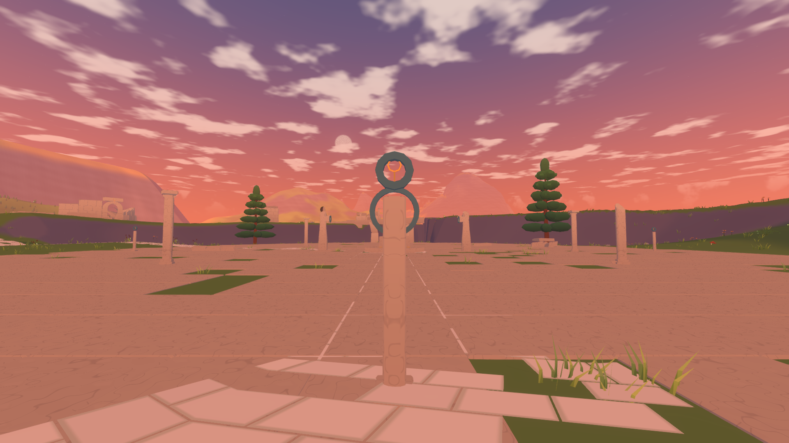 | 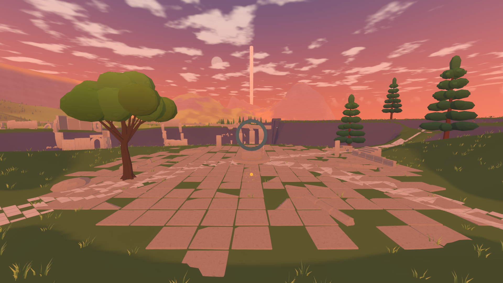 |
| 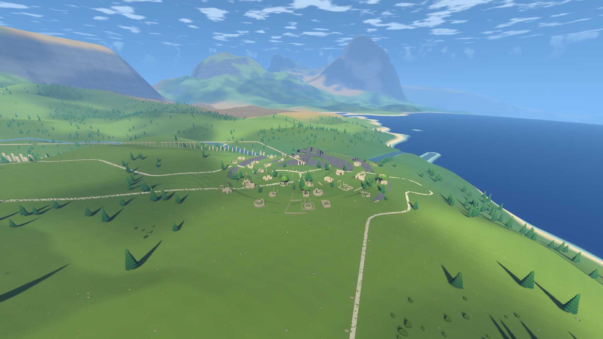 | 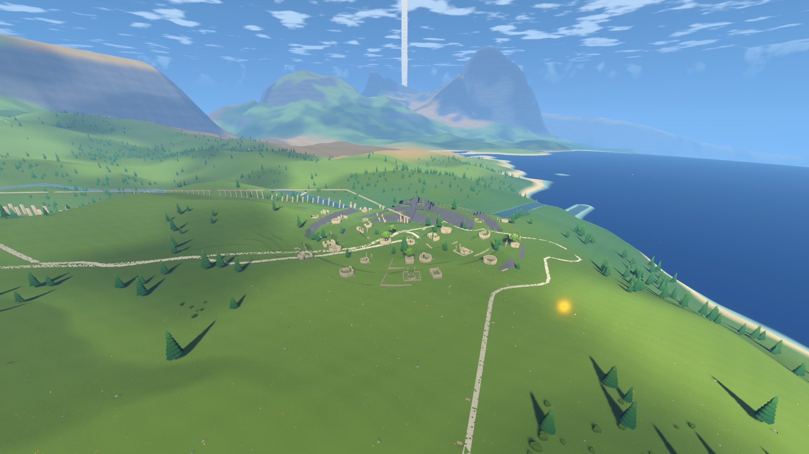 |

## 神殿大厅

增加壁柱、墙脚台基和檐口；六块浮雕恢复四乘三米尺寸，刻线加粗三倍，板下增加低灯。巨像移入天井光束，台座加高一米；环境光下限 0.18，强化光斑与反弹光。地面混合大小石板，墙边积土与碎石，中央回声位置嵌入环与径。

已打开六块浮雕四视图及大厅截图；大厅能够同时辨认光束、巨像和至少两块壁画。本轮回声接地与洞穴检查已重新执行并通过。

| 修改前 | 修改后 |
| --- | --- |
|  | 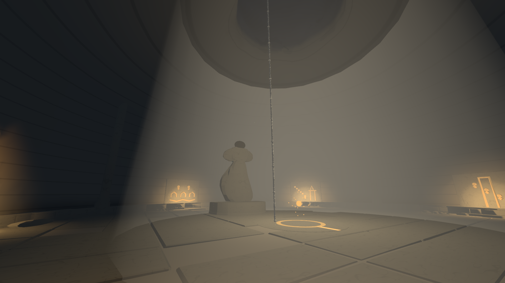 |

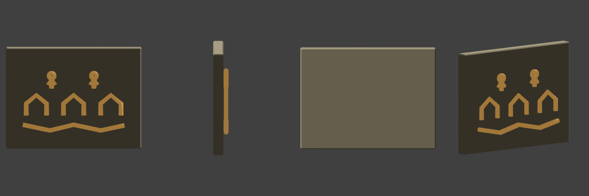

## 烽火塔顶

火盆改为浅铜盆、外翻盆沿、三条曲足和落地足垫，增加环与径浮雕、炭块和灰。四层尖状火舌分别摇动，颜色从橙红、琥珀过渡至浅色内芯，另有分离火苗与少量上升火星；暖光照亮塔冠。固定机位冻结相位和粒子速度。

76 项构件检查通过。此前 s35 平均 10.653 / P95 11.982 毫秒，s36 为 11.442 / 13.150，帧时间通过；上传 5.367、7.023 毫秒超预算，保留原始结果。

| 修改前 | 修改后 |
| --- | --- |
|  |  |
|  |  |

## 验证边界

只修影响游玩与规格 25 明确列出的缺陷，不增加新的自动试玩系统，不再为轻微性能超标反复修改。最终执行一次 `Test-Acceptance.ps1 -Scope all`，后续仅复查真实失败项。性能偏差、未检查的路线和听感项目分别如实记录，不能据此宣称全部验收通过。

本次整体检查发现，旧攀爬出口没有随地形和石塔布局更新。现已在世界烘焙中同步生成路线，把入口坡度按改宽后的岩壁调整为一，并保留 120～200 米的总高差要求；末段延伸至缓坡。已经删除无实体石塔对应的运行时绳索，十条实际攀爬路线与栈道绕行复查全部通过，出口最大误差 0.326 米。攀爬跳离同时修正为立即离开支撑面、保留 0.2 秒向外速度，复查向外速度 3.036 米／秒。

## 主线通行修复

连续主线检查确认广场倒柱需要绕行；回声触发范围允许从侧面进入，不必站到中央纪念物。出城道路此前沿人工台地局部坡度过大，城内道路现按设计高度完整整平，城外逐渐恢复一点五米整地限制。梯田与台地挡墙按道路宽度加一点五米预留缺口，同时移除对应模型和碰撞；广场平整范围与二十二米铺地保持一致，塔基整平最后执行，消除边界突变。洞穴支路先到洞外缓坡起点，再沿坡进入洞门，避免道路从洞顶折返。

道路检查由仅比较十米端点改为一米间隔采样，避免漏掉短陡坡。最终通行与完整验收结果见第一版记录。

洞口端帽在正常步长下仍形成矮坎，单纯延长距离场只能移动接缝。最终保留十六米延伸，并在主入口平段外沿裁去端帽，让地形与洞底重叠连接；地形与裁切共用十二米边界，渲染和碰撞仍使用同一网格。洞穴通行检查改用正常物理步长，避免放大步长越过短障碍而误判通过。

天梯地面衔接补充：原有地标占地判断误将整片基座台地禁止降落，现开放主门前外侧台地的窄范围，逐个起落架检查水面与平整度；未改变地形或降低高差阈值。实际降落及沿正面石阶进入主门已通过，塔身和扶壁区域继续保护。游戏中可在主门外约一百五十米处降落，先对准正面石阶再进入。

## 主线分段自查（2026-10-24）

已用实际角色移动、跳跃、驾驶、落地、站立与回声播放，从出发地按断点接续检查至字幕结束并恢复控制。接续时只恢复此前确已完成的回声与已点亮烽火；没有直接完成新回声。**这不是单一进程、不中断的整次通关**。临时驱动与原始成功、失败报告保留在 `test-output/wanderer/`，不进入产品或提交。

| 段落 | 本轮计时 | 结果与边界 |
| --- | --- | --- |
| 出发地 → 古道飞行 → 古城日常回声 | 飞行 77.2 秒；含降落、登船和观看约 137.1 秒 | `main-route-delivery-v4`；广场绕过倒柱，在触发范围内观看 |
| 古城 → 回声洞 → 大厅回声 → 返回洞外 | 道路加速步行 315.1 秒；含洞内往返、观看约 467.9 秒 | 同上；整条道路和洞口已实际通过，不能按纯步行耗时理解 |
| 塔链 → 末塔守望回声 | 沿链飞行 79.0 秒；守望回声 21.3 秒 | `main-tail-v4` 与 `main-finale` 接续；首塔上下行另有实际结果，山口塔完整上下行未复查 |
| 天梯主门 → 启程回声 → 观景环往返 | 门前步行 21.4 秒、回声 25.1 秒；单程等待与行程约 75.3 秒 | `main-tower-ending` 与 `main-gate-ending` 接续；纯升降行程 75 秒，上下行及走出、返回均通过 |
| 观景环实际外缘 | 外缘半径 59.0 米，往返各约 3.5 秒 | `balcony-edge-delivery`；误差 0.003 米以内，实际眼高 1.62 米；古城只占很小的浅色轮廓，辨识仍弱 |
| 外侧台地登船 → 断口停泊台 | 登船 8.3 秒，飞行 7.6 秒；降落成功 | `main-gate-ending`；地面台地约在主门前 150 米，沿正面石阶通行 |
| 停泊台 → 石环 → 栈桥 → 终章 | 进入石环 1.2 秒、环行 22.5 秒、栈桥 14.3 秒、终章 32.1 秒 | `main-bridge-ending`；修复护栏后实际通过；源码回归也从真实下船位置验证整段 |
| 空中召回 → 光之路 → 字幕返回 | 召回 8.0 秒；光路累计 60.016 秒；字幕约 23.0 秒 | 同上；实际字幕截图和返回后的驾驶状态、控制恢复均已检查 |

计时采用游戏内时间。长距离道路使用加速步行，部分非关键段使用二倍时间；石阶、平台和精确落脚采用正常物理步长。召回等待、地形加载和接续初始化不具有固定耗时，不能把这些分段相加当作真实首次游玩的时长。古城至洞口目前约 2.5 公里，普通步行约十分钟，短于圣经十五分钟的目标，暂不为延长时间额外绕路；古道普通步行仍约四十五分钟。

主线实际截图：[古城](images/wanderer/first-playable/daily.png)、[大厅](images/wanderer/first-playable/faith.png)、[点亮后的末塔](images/wanderer/first-playable/watcher.png)、[天梯主门](images/wanderer/first-playable/departure.png)、[观景环外缘](images/wanderer/first-playable/balcony.png)、[终章圆台](images/wanderer/first-playable/ending.png)、[字幕](images/wanderer/first-playable/credits.png)、[返回驾驶](images/wanderer/first-playable/return.png)。部分回声人物不在当时相机正前方，这些照片仅证明地点与对应时刻；不能代替专门的回声动画与接地检查。

断口停泊台和栈桥连接处原有护栏封路，现已在 Blender 模型中保留两处通道，渲染与碰撞共同更新；没有让角色穿过栏杆。新模型四视图已打开检查：

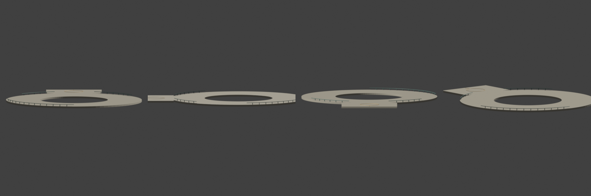

仍未复查或未完成：山口塔入口需要跳上首阶，完整上下行没有以真实角色重新验证；回声洞第二出口的洞外衔接未重新检查，且未连接规定河谷；洞内 HUD 的“离地”仍可能显示相对外部地表的负值；夜间大厅巨像阴影较重。古城外围挡墙排列、梯田轮廓、大地图背景比例、观景环古城辨识度以及个人听感仍保留为后续细节。第一版之后的洞穴、植被、动物、地标与飞船重做不属于本次收尾。

最终源码复查补充：回声洞侧厅按固定角度排列的石碑挡住了拟合后的出口，正常物理步长下返回岔路会停在碑前。现按实际出口方向保留三米通道，模型与碰撞共同移除；原始失败与修订后的两条完整行走报告分开保留。断口俯视机位也移到加宽后停泊台的外缘，避免只拍到脚下石板。

洞穴专项最终通过：两条完整路线分别 179.800 秒与 127.933 秒，停滞时间均为零，最大路径误差 1.124 米。六类非法存档全部拒绝，旧档与往返通过；53 个网格块、231433 个三角形、6384 对共享顶点误差不超过 0.000016 米。无界面复查单帧创建峰值 23.046 毫秒、碰撞创建 8.032 毫秒，高于创建预算；首轮全套为 2.751 毫秒，两个原始结果都保留，未再为峰值反复调参。

最终 Windows 包已重新导出，包内资源、核心功能与五个受影响机位复查通过，文件与压缩包哈希一致。全套首轮 89 项与后续专项分开保留，详见[第一版性能及验收记录](远行者第一版性能对照.md)。全部 56 个机位已打开看图；烽火塔夜景 s36 近处挡墙仍可见尖长、重复构件，未在本轮全面重做，列为已有模型遗留。

[修正后的断口俯视图](images/wanderer/polish/after/s60b_ladder_view.png)、[终章回声固定机位](images/wanderer/first-playable/ending-echo.png)已打开检查；固定机位用于看图，不计入实际主线用时。
