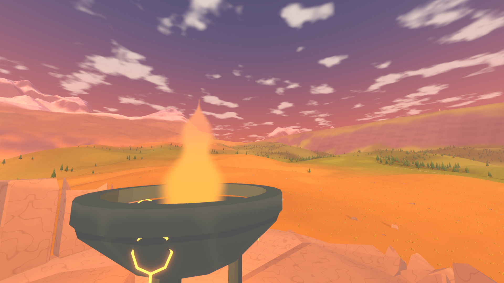
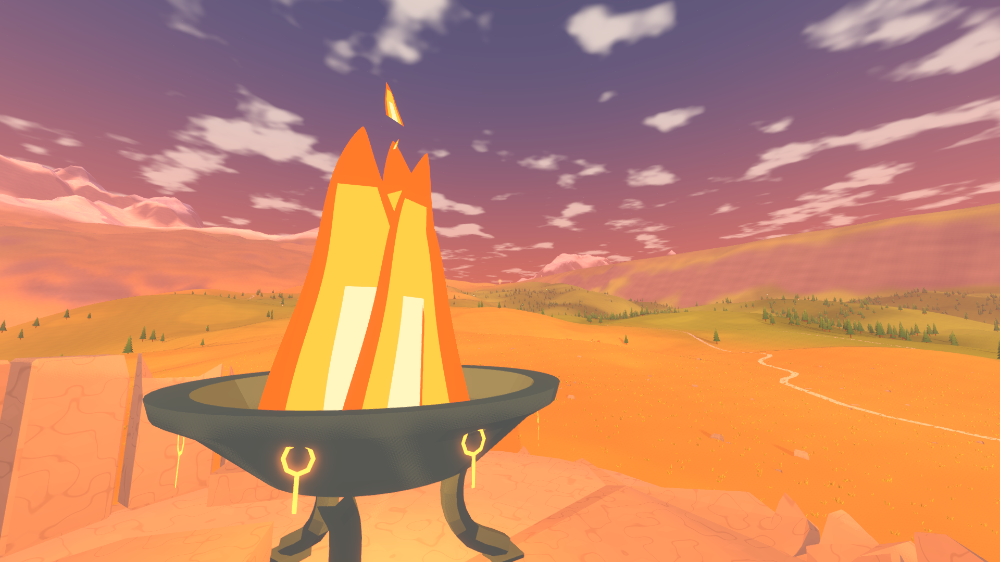
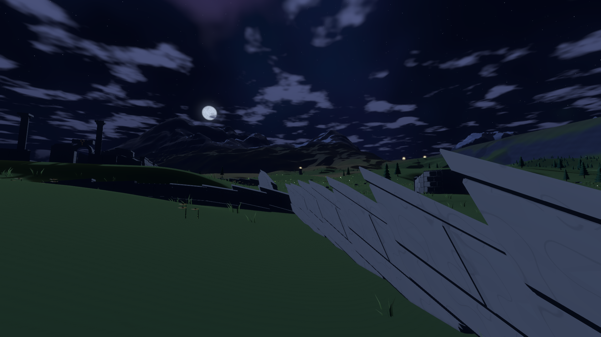
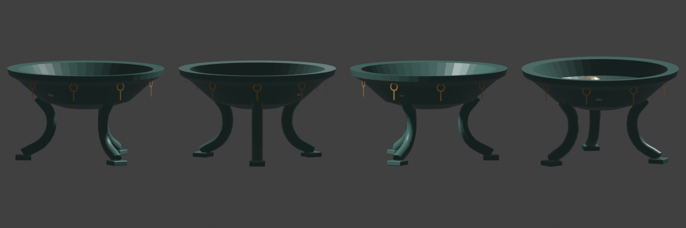

# 画面打磨记录

第 25 步进行中，尚未完成五项验收，不能标记第一版可玩。

## 烽火塔顶

火盆改为旋转截面的浅铜盆、外翻盆沿、三条弯曲铜足和落地足垫，补充环与径浮雕、炭块。火焰使用四个独立摇动的清晰火舌，橙红、琥珀与浅色内芯分层，另有分离上升火苗和少量火星；暖光照亮塔冠。固定机位冻结相位和粒子速度。

76 项构件检查通过，包括两条路线尺寸、顶点色、面数、碰撞与残破版范围。实际游戏截图已打开确认轮廓和火盆；s35 平均 10.653 / P95 11.982 毫秒，s36 为 11.442 / 13.150，帧时间通过。上传分别 5.367、7.023 毫秒，仍超过四毫秒预算，未将其标记为通过。

| 修改前 | 修改后 |
| --- | --- |
|  |  |
|  |  |

## 峡谷进行中

降低配色对比，使用浅赭、暖灰、淡红褐及不等宽色带，并加入纵向风化纹理。冰川与河道配色不变。六个受影响机位的帧时间通过，完整数字在 test-output/wanderer/25-shots/summary.md；部分上传仍超预算。

大台阶的两种宽坡方案均使离线文明选址无法找到合格古城河岸，日志保留在 test-output/wanderer/25-canyon-bake-failure.log。已恢复原几何，未修改选址阈值；因此锯齿仍未解决，本项未完成。候选代码保留在 test-output/wanderer/25-canyon-candidate.gd.txt，不参与运行。

## 广场与神殿进行中

广场半径调整为二十二米，房屋向内靠近，改成残缺铺地、窄缝草与错落的生活遗迹。神殿增加壁柱、台基、檐口、浮雕下方照明，放大壁画至原始四乘三米并将刻线加粗三倍，调整巨像台座、天井与环境照明。重新烘焙 200.7 秒成功；839 个回声时刻的真实碰撞接地通过，最大偏差 0.18147 米；大厅 s38 平均 9.744 / P95 11.032 毫秒，信仰 s47 为 10.332 / 11.634，帧时间通过；广场 s30 平均 13.976、回声 s46 平均 13.048 毫秒，仍超预算。文明检查的广场高度、建筑基础、塔链与结局通过，但升降台乘坐失败；正在检查浮动原点与移动平台的相互影响，尚未判定本项通过。

## 尚未完成

峡谷几何、天梯尺寸与近景结构、观景环视线与高度、广场和大厅的最终自查，以及全部画面改动后的性能优化。随后执行第一版完整验收、连续主线试玩和最终导出包检查。五项问题均按规格 25 继续修正，不作为可跳过的遗留项。
