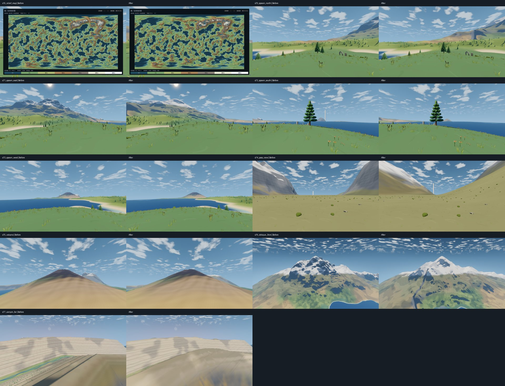

# 地形重塑记录

2026-10-26 保存检查点。分支 `ai/wanderer`，渲染基线提交 `e5401e8`。高度场、选址和重新烘焙已实现，功能定向复查通过；发布性能、严格全球汇水和 Claude 审图尚未全部通过。用户要求本轮测试结束后停止，当前已经停止，不追加测试，不进入第 3 步。

## 已实现

- 六面 512 格意图导出，包括低频地势、山脉、峡谷、火山、保护区遮罩和原始布局；出生区另外保存八米间距的原始地形样本。
- NumPy、Numba 单线程离线生成 2048 格高度场：域扭曲脊状噪声及导数衰减、名峰和山口、非圆锥火山、平滑峡谷、水滴侵蚀、多尺度热力侵蚀、优先填洼和出生区保护。
- `DawnHeightfield` 读取压缩资源、跨面边框及双三次插值；出生区以八米原始采样局部加密，外侧平滑过渡。晨在保护区之外增加小尺度噪声。烬、霜的高度分支保持原样。
- 运行时删除山脉和火山主体叠加，峡谷仅保留十级不等高岩层；共用低饱和度层理和竖向流痕。
- 古城评分加入真实寻路距离，二十分钟上限按普通步行四米每秒计算；回声洞第二出口必须通向河谷。

## 基线与几何检查

改动前先测量 `height()`：20,000 个固定球面方向，预热一轮后测五轮，单次查询耗时中位数 **8.93675 微秒**。报告 `test-output/terrain/height-before.json`。

最终高度场检查：接缝最大高差 **0.07374 米**、法线夹角 **0.49347°**，覆盖十二条棱；峡谷和名峰之外超过 45° 的陆地比例 **1.66746%**；180 米周期直方图峰值与平均值之比 **1.19181**。`height()` 查询中位数 **8.00865 微秒**，基线为 8.93675 微秒。八米间隔 196,321 个基础高度样本最大偏差 0.03806 米，1257 个旧版最终高度样本最大偏差 0.06876 米。报告位于 `test-output/terrain/acceptance-final-source/landforms.json`。

早期仅按一百米抽样，得到的出生区最大偏差 0.85664 米未能覆盖小范围异常。八米抽样后来发现 99 个最终高度超标点，最大 2.95894 米。原因包括全局约三十一米格距损失细节，以及新旧道路整地差异。资源增加八米原始采样，保护区不重复添加细节噪声，并保留旧道路整地。四米间隔共 **785,349 个样本**，基础和最终高度最大偏差均为 **0.45697 米**，没有超标点，报告 `test-output/terrain/birth-dense-4m.json`。

第一版最高峰 3950.00 米，峡谷最大深度 796.56 米；按 `e5401e8` 代码和旧资源重建，1257 个出生区基准样本最大误差约 5.12e-13 米。

本轮最高峰实测 **3932.45 米**，峡谷最大深度 **840.17 米**，峡谷曲线全长 **29.273 公里**；两处山口可在坡度不超过 0.35 的格网上贯通，第三处没有满足条件的路线，规格要求至少两处。峡谷谷底沿下游保持单调下降。

改动前八个地形机位和地图截图位于 `test-output/terrain/before/`。原始世界、洞穴、布局副本和主线距离位于 `test-output/terrain/original-data/`、`original.json`。第一版古道 10822.05 米，神殿道路 2456.43 米。

## 选址与路线

最终候选直接使用侵蚀后的自然河岸，没有额外雕刻河流或河岸。水系格网从 384 增加到 768，避免粗格网遗漏低地通道；资源版本同步增加至 2，旧索引必须重新烘焙。

古道从约四十五分钟缩短至十五至二十分钟，采用本步规格的明确目标；它优先于同一节通用的“各段距离变化不超过 30%”。古城搜索范围改为地表距离 3.0～4.8 公里，并用实际寻路长度约束在 3.6～4.8 公里。原有河岸坡度、汇水面积、河岸距离和取水高差限制保持不变。选址和正式古道共用同一条路线，出生地到古道起点的自然进路也计入步行总长，最终按真实地形的一米采样累计距离。

水渠逐个验证同河道上游的取水候选，间距至少 64 米，上溯上限八公里；保留高出广场十二米及最大开挖 1.2 米的限制，避免第一个候选不适合便终止整个烘焙。

## 地点与路程

位置以星球局部坐标的单位方向表示：

| 地点 | 第一版 | 本轮 |
| --- | --- | --- |
| 古城 | (-0.489187, 0.777990, 0.394242) | (-0.424729, 0.835242, 0.349251) |
| 回声洞 | (-0.462786, 0.774078, 0.432009) | (-0.402434, 0.834568, 0.376221) |
| 第一烽火塔 | (-0.477247, 0.782482, 0.399947) | (-0.428280, 0.828437, 0.360929) |
| 天梯 | (-0.696572, 0.623854, 0.354392) | (-0.608217, 0.660035, 0.440938) |

| 地表距离 | 第一版 | 本轮 | 变化 |
| --- | ---: | ---: | ---: |
| 古城至回声洞 | 1850.00 米 | 1400.00 米 | -24.3% |
| 回声洞至第一烽火塔 | 1446.59 米 | 1226.05 米 | -15.2% |

上表使用同一地表大圆距离口径，均在 30% 范围内。最终道路按一米间隔累计实际高度：古道 4376.37 米、神殿道路 2133.47 米、第一塔道路 655.13 米、墓园道路 3006.51 米。墓园属于支路，不作为主线节奏约束。

最终验收再按一米间隔累计实际高度：古道 **4376.37 米**，加上出生地至古道起点的自然进路，完整路程 **4629.25 米，普通步行约 19.29 分钟**。本轮自然进路与第一版不同，第一版完整路程没有按相同口径实测；不将原来的二维道路长度直接当作完整步行距离。

## 通行检查与修复

- 山口塔在实际地面和构件碰撞中，以正常物理步长完成登顶与下行，包含入口短跳和断口跳跃，往返约 25.10 秒。塔冠入口反向通过也需要短跳，检查按相同操作复查，未修改游戏碰撞。
- 天梯实际完成两次行程，约 159.23 秒，乘坐时有效贴地比例 1.0，最大相对高度偏差 0.275 米；观景环离开与返回均通过。
- 回声洞出口沿实际通道方向延长端帽，并对齐出口构件；外侧增加二十米缓坡，洞壁在重叠处裁切，地形与洞底共同支撑角色。开洞只移除脚部进入实际空腔的地面，保留低于洞底的地表；局部裁切容差保留细小起伏的洞底。主厅绳索移至进厅路线侧方，避免普通行走时自动附着。
- 原检查只到出口节点，逐次操作发现继续向外会碰到端帽。最终检查将两条路线延长到洞外二十米，分别用时 206.85 秒和 153.40 秒，均离开洞穴判定且正常着地，最大路线偏差约 0.722 米；返回检查 5.32 秒通过。入口、河谷出口及天井的中心遮挡和非法开洞三角形均为零，渲染与碰撞对应；天井绳索攀爬通过。
- 五段回声逐点碰撞检查通过，共 839 个采样点，无缺失接触点；最大误差约 0.279 米。
- 出口局部正常步行往返通过，出洞 4.80 秒、返回 5.32 秒，均正常着地。另按截图逐次决定方向和动作，实际从洞内走到河岸，再转身走回洞内，全程没有跳跃，地面缺口已消除。控制器调用游戏输入动作，不作为系统按键持续按住的手感结论；原图与状态保存在 `test-output/interactive-terrain-linked/`。
- 植被检查原先重新搜索了另一个海岸，误称为出生区。改为读取已固定的出生布局后通过，没有改动植被规则或降低数量要求。

## 当前生成命令

在仓库根目录，先安装 `tools/requirements-bake.txt` 中的烘焙依赖，然后执行：

```powershell
& tools/Check-Godot.ps1 -GodotArgs @('--headless','--script','res://scripts/tools/terrain_intent_export.gd','--','--check=terrain-intent') -LogPath 'test-output/terrain/intent.log'
python tools/Bake-Terrain.py --godot 'D:/Godot/4.7.2/Godot_v4.7.2-stable_win64_console.exe'
& tools/Bake-World.ps1
```

本机使用工作区自带 Python 3.12，NumPy 2.5.4、Numba 0.68.0 安装在忽略的 `test-output/terrain/python-libs/`，调用时通过 `PYTHONPATH` 指定。最终参数、耗时、哈希和资源大小写入 `test-output/terrain/baked/metadata.json`。资源头排除耗时，避免相同输入因运行时间不同而改变二进制结果。

默认每面 500,000 滴、每滴最多 80 步；侵蚀刷半径三格，蒸发率 0.015，最大携沙量 40；热力侵蚀休止角 35°，先在 128、256、512 格分别迭代 96、80、64 次，再在最终格网上迭代十二次。加入八米保护区采样后，高度场压缩资源 **45,932,126 字节，约 43.80 MiB**，超过规格的 25～35 MB 估算。该次地形生成约 **169.73 秒**，其中保护区混合后的第二次汇水整理约 12.00 秒。

## 水系与重复生成

| 指标 | 第一版 | 本轮最终烘焙 |
| --- | ---: | ---: |
| 河流总长 | 1975.250 公里 | 2030.259 公里 |
| 河流数量 | 1656 | 1329 |
| 湖泊数量 | 1777 | 380 |
| 湖泊面积 | 718.765 平方公里 | 462.301 平方公里 |
| 瀑布河段 | 8447 | 4433 |

最终世界烘焙约 203.35 秒。水系检查确认河流下游水位不升高、末端均连接海洋、湖泊或其他河流，抽样河床全部低于水位；出生区附近查询平均 5.47657 微秒。

同一意图与参数连续执行两次 128 格、每面 500 滴、每滴十步的小规模生成，六面高度数据哈希均为 `151aaec1c1dddc4207d9ca5af0f1dcdeb9d39a54f62e4a5cb27aa931ba073417`。正式资源使用 2048 格和每面 500,000 滴；新增局部采样输出后曾重新执行正式生成，六面高度数组哈希与上一轮相同。

正式输入哈希：`838e83399ef5267ae692ba9213b0ef1e2809e71896012e3d21ae0ed2b496ca68`。高度数组哈希：`ab1e83166e86d562ae3a77873d0da658f6eaa5c365f4bd0cd7277d1cb8968927`。算法哈希：`9334e33ad9f88e7cbd30ec128bed745f3e0bde2c60c9cb70fef406f17e1dc206`。八米保护区数组哈希：`6e81de1c8c92bc1b2b4f000e631fdaeb3c78f74968ce78c21ef129ce371fcb8e`。

## 保护区与汇水差异

保护区只恢复旧的基础地势仍不够：新水系在其中重新雕刻，曾造成最大约 18.33 米的最终高度变化。因此冻结第一版保护区相连的三条河流和一个湖泊为 `dawn_spawn_water.res`，在新水系生成后替换对应局部汇水区，再建立索引。该资源同时保存附近旧道路的整地数据，保护区内保留原地面，在外侧过渡到新道路。水系和旧道路均从第一版资源导出，运行时不读取历史代码。

本次优先保留出生区原地形，没有为消除旧洼地而整体改变保护区。最终混合后再次填洼，新生成区 15,302,149 个陆地格子的父链没有逆坡或陆地终点；保护区保留 434 条不符合该检查的原地形出水边。在全局格网上另查得保护区有 56 个非湖泊陆地局部最低点，邻格最低抬升约 0.019～2.077 米；这份粗格网统计不能代替八米局部采样的完整流向验证。第六节要求的严格全球汇水尚未全部满足，不能以生成区通过代替，仍待审查。

## 最终测试结果与停止位置

| 轮次 | 结果 | 原始报告 |
| --- | --- | --- |
| 首次 dawn 全套 | 发现问题后中断修复，不能视为全套通过 | `test-output/acceptance/summary.json` |
| 最终功能定向复查 | 水系、地形、文明、洞穴、回声地面、植被、运行时植被、材质共 8/8 通过 | `test-output/terrain/acceptance-final-source/summary.json` |
| 最终发布定向验收 | 42/42 执行完毕，34 通过、8 未通过；`full_suite=false` | `test-output/terrain/acceptance-final-release/summary.json` |

发布构建、资源、核心、世界、启动、步行和归档哈希检查通过。以下六个机位超过平均 12.5 ms、P95 16 ms 或上传 4 ms 的预算：

| 机位 | 平均 / P95（ms） | 最大上传（ms） |
| --- | ---: | ---: |
| 地形图 s15 | 14.506 / 16.336 | 4.199 |
| 峡谷底 s52 | 14.620 / 18.152 | 3.571 |
| 出生地东向 s71 | 12.970 / 15.271 | 1.884 |
| 古城广场 s30 | 14.987 / 17.827 | 2.376 |
| 古城全景 s31 | 14.322 / 15.774 | 3.923 |
| 天梯基座 s43 | 16.035 / 18.749 | 3.047 |

冷缓存降落实际着陆通过，用时 57.69 秒，平均 7.281 ms、P95 10.025 ms、最大上传 2.036 ms；三秒后仍有四帧超过 50 ms，最大 227.155 ms，因此性能未通过。回声广场 s46 的性能通过，但日志出现 `WASAPI: GetBufferSize error` 和输出设备失效警告，验收因此失败；不将其记为性能失败，也未重新测试。

本次发布包为 `build/StarSea-Windows-x64.zip`；其中 `StarSea.exe` 的 SHA256 为 `3A18082D77D9C12D17A5D42BCBE4FF02DE11C07FA140554401D76452095E0B7E`，已与 `build/StarSea/sha256.json` 清单核对。构建产物与原始测试报告保留在忽略目录。原用户存档 SHA256 仍为 `6C35D19FADB4031AA88DDE483A1FEFDB00B86550ED81B5524DAA5BBCA89B94C4`。

严格全球汇水、资源体积、上述性能及音频日志问题均保留；Claude 审图待进行。按用户要求停止，不再补测或继续开发。

## 机位对比

使用改动前与最终发布包已有截图生成彩色、灰度对比，不再启动游戏。参考对照草图保留在 `test-output/terrain/review-draft/`；参考原图保留在忽略目录，不纳入项目素材。以下仅为 GPT 自查，不能代替 Claude 审图。

| 机位 | 对比 | 自查结论 |
| --- | --- | --- |
| 全球地形图 | [s15](../images/地形重塑/s15_relief_map.jpg) | 山脉与低地分布更不规则；地图性能仍超预算 |
| 出生地北向 | [s70](../images/地形重塑/s70_spawn_north.jpg) | 保护区近景基本保留，远山轮廓连续 |
| 出生地东向 | [s71](../images/地形重塑/s71_spawn_east.jpg) | 山坡减少密集折线，远近明暗可区分；性能超预算 |
| 出生地南向 | [s72](../images/地形重塑/s72_spawn_south.jpg) | 近景地面与远山有层次，未见整面等高台阶 |
| 出生地西向 | [s73](../images/地形重塑/s73_spawn_west.jpg) | 海岸与山坡过渡较连续，灰度轮廓可分辨 |
| 山口 | [s74](../images/地形重塑/s74_pass_view.jpg) | 山体轮廓更连贯，塔随新地形重新选址 |
| 火山 | [s75](../images/地形重塑/s75_volcano.jpg) | 两侧坡形不再完全对称，主体仍有锥形轮廓，等待审图 |
| 三公里斜视 | [s76](../images/地形重塑/s76_oblique_3km.jpg) | 山脊与侵蚀沟谷连续，减少阈值形成的台阶 |
| 峡谷远景 | [s77](../images/地形重塑/s77_canyon_far.jpg) | 细密白色等距线已去除，改为较宽的不等高岩层 |



## 实现依据

[水滴侵蚀算法与公开实现](https://github.com/SebLague/Hydraulic-Erosion/blob/master/Assets/Scripts/Erosion.cs)。仅参考水滴携沙、侵蚀和沉积算法，球面跨面处理、意图生成、热力侵蚀与资源采样由本项目实现。

## Claude 审图（2026-10-26）

**结论：不通过，需要修正一轮。** 工程部分扎实：第一版的等高台阶、密集折线、公式边界都已消失，保护区、山口、选址、水系连通、古道约 19 分钟、洞口往返、回声逐点碰撞都按规格落实，记录诚实。画面上侵蚀几乎看不出来，山体变得光滑平淡，火山没有变化，峡谷变差。修正要求见 [11 地形重塑](../11-地形重塑.md) 第三节。

| 项目 | 判断 | 依据 |
| --- | --- | --- |
| 公式痕迹 | 通过 | `s76` 改动前山坡上的成排锯齿消失；`s70`～`s73` 没有整面台阶 |
| 侵蚀效果 | **不通过** | `s71`、`s74`、`s76` 的山体是光滑的大坡，看不到分支冲沟、冲积扇、刀脊，比改动前更平淡。原因：每面 2048²（约 420 万格）只用了 50 万滴水，平均每格 0.12 滴，公开实现一般每格 1～3 滴；另外烘焙噪声最细约 160 米波长，规格又把运行时细节限制在 3 米以内，50～300 米这一档起伏没有来源（后者是规格本身的缺口） |
| 火山 | **不通过** | `s75` 改动前后几乎相同，仍是光滑正圆锥，没有冲沟 |
| 直沟 | **不通过** | `s76` 山坡上一道又窄又深、近乎笔直的暗沟，像裂缝 |
| 峡谷 | **不通过** | `s77` 远壁仍是整面细而平行的横线（千层蛋糕只是变淡）；近处原有的台阶和谷底河流被一个模糊的大土坡盖住 |
| 全球格局 | 可接受 | `s15` 海陆格局与第一版基本相同，这是保留意图图的预期结果 |
| 保护区汇水例外 | **接受** | 保护出发地优先；434 条旧地形出水边写进规格作为允许的例外，不再算未通过 |
| 资源体积 | 有条件接受 | 43.80 MiB 可以接受，但修正轮不得继续增大；仓库里每重新提交一次就多一份大文件，只在修正完成时提交一次 |
| 性能 | **不通过** | `s43` 从第 1 步的 10.58 ms 升到 16.035 ms；`s15`、`s52`、`s71`、`s30`、`s31` 超预算；冷缓存降落最慢一帧 227 ms |
| 音频错误 | 复测 | `s46` 的 WASAPI 错误更像本机音频设备偶发问题，修正轮复测一次，复现再查 |
