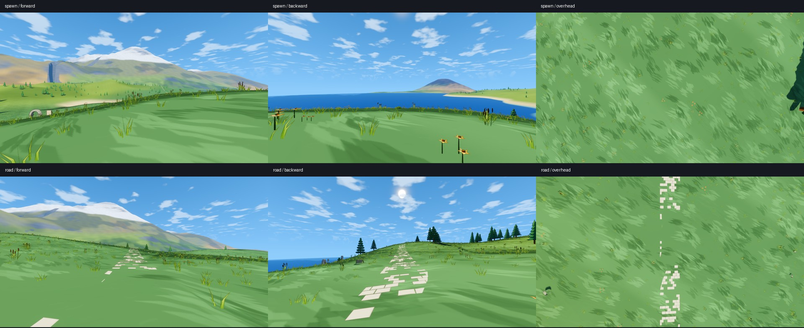
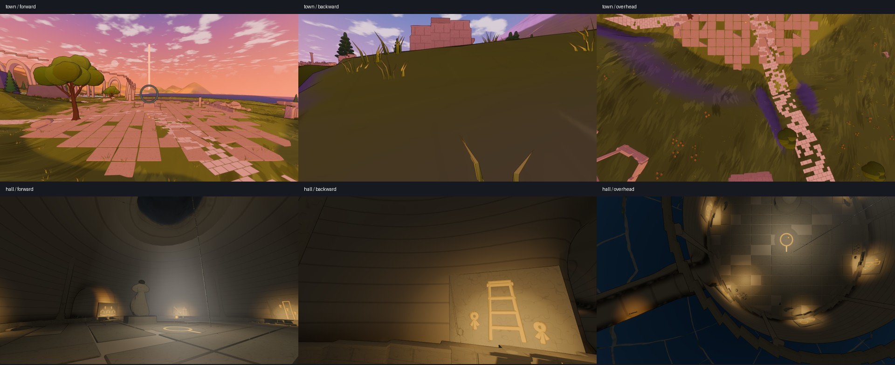
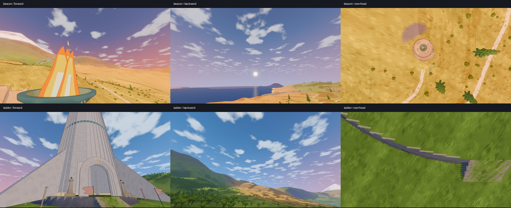
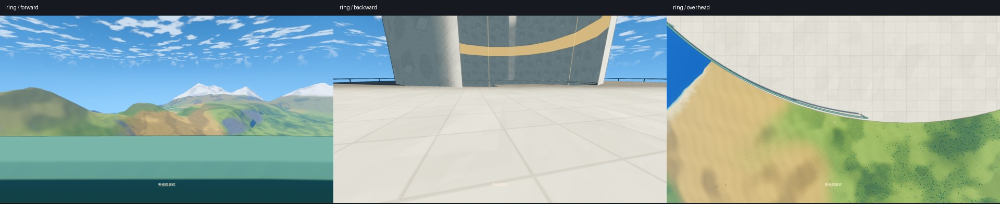
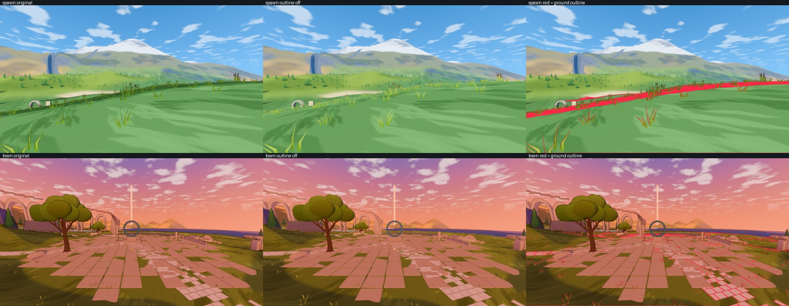
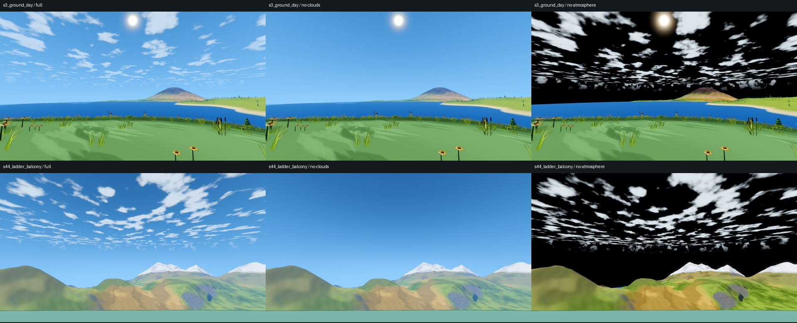

# 自动检查记录

2026-10-27。第二版第 1 步已建立八项检查和统一入口，并完成一次现状检查。用户追加的天空问题另有回归检查。本步没有修改地形、模型、玩家控制器、游戏着色器或玩法。游戏验收仍未通过，不能称为第二版完成。

## 执行与报告

```powershell
& tools/Test-Acceptance.ps1 -Scope version
```

画面统计需要 NumPy、Pillow。入口先使用 `python`，缺少依赖时尝试本机 Codex 自带 Python，也可传入 `-PythonExecutable <路径>`。历史原图默认放在 `test-output/version-baseline/`；`sources.json` 保留来源、哈希、分辨率。七张原图的哈希已核对，不能用本次截图冒充历史基线。

- 首次完整入口：`test-output/acceptance/version-runs/20261027-204226-963/`。原八项都生成报告，并继续执行 98 项既有验收；既有验收 88 项通过、10 项失败。单项失败没有中断后续项目。
- 检查器定向修正：`test-output/version-repair/version-runs/20261027-220709-420/`，包含摆放、模型、巡检、画面、天空和主线等报告。
- 阻挡物名称最终复查：`test-output/version-stuck-final/version-runs/20261027-223038-759/`。
- 行走复查：`test-output/version-walk-repair/`；观景环最终有效结果在 `test-output/version-ring-final/`。
- 合并索引：`test-output/acceptance/version-summary.md`、`version-summary.json`。明确标记为多个定向报告的合并，`full_suite=false`、`coverage_complete=false`；原始完整报告保留，不能把它改写成最终代码的一次全新完整验收。

之后只复查修改过的检查器，没有重新启动整套验收。定向入口示例：

```powershell
& tools/Test-Acceptance.ps1 -Scope version -OnlyChecks @('stuck', 'mainline') -ReportDirectory 'test-output/version-repair'
```

卡住断点签名包含世界数据、控制器、构件及检查器源码；有关内容变化后重新检查。`full_suite` 仅说明选择了全部项目，不能代替 `coverage_complete`。

## 方法、范围与现状

| 检查 | 方法与阈值 | 结果 |
| --- | --- | --- |
| 卡住 | 从烘焙数据派生出发地、道路、城镇、桥、洞内前厅与大厅、九塔阶面、天梯、断口栈桥及主线附近河口。2 米铺点，8 方向，10 米试走；32 个互不碰撞的真实 `StarSeaPlayer`，生产控制器与 `move_and_slide`，固定 1/60 秒。0.5 秒位移不足期望的 20% 即失败；排除占用起点和高于 1.2 米的正常墙柱等障碍 | 最终 448 条试走中 130 次失败，排除 160 条占用起点、28 条正常高障碍。117 次涉及石板、13 次涉及广场环；93 次有滑动碰撞接触，37 次由近距离探针补充候选名称，并明确区分来源 |
| 摆放 | 10,199 个来源，含文明构件、九塔、洞内摆设、地标、天梯独立模型、主线附近 875 个植被格子。16 米空间索引；地面重叠 0.05 米、穿插 0.1 米、离地 0.1 米、碰撞外扩 0.2 米。地面进一步求实际朝上三角形交集宽度下界；支撑查询实际网格，洞内结合洞穴场函数 | 37 组地面重叠候选中 23 组有实际三角形交叠证据；另有 1,239 组一般穿插、17 组同面、167 个离地、7 个埋没、4,012 个缺少碰撞、69 个碰撞外扩的结果。一般穿插与同面主要使用包围盒筛选，标注需看图复核，不能把全部数量当作确诊 |
| 模型 | 109 个 glb、154 个网格，含实际野外石头三个细节层级。0.1 毫米合并同位置顶点；开放边、共边方向、非流形边、退化面、Godot 顺时针体积、各连通部分体积、顶点法线、分类面数、顶点色 | 113 个网格至少一项失败。初次仅查总体积时为 112 个；补充连通部分后，`wall_arc_broken` 检出一个约 -0.1791 的反向部分，不能靠其他正体积部分抵消 |
| 水面 | 生产 `WaterChunks._generate()` 的实际三角形和海平面球面。逐个河口接缝 ≤0.3 米；前后各 20 米逐米查水层和两岸；坡度 >1.5 的连续岸壁 ≤3 米 | 703 个河口未通过，主要检测到河面与海面重复。并非每个河口都有接缝高差：河流 0 的高差只有 0.0078125 米，仍有 41 个重复水层采样 |
| 画面 | 七个正向机位；天空和草地 S/V ≥历史的 95%；原图矩统计搜索面积 >5%、亮度标准差 <0.02 的连通区域；冻结同一场景，比较开关描边图，再与地面分类图求交，密度 ≤4% | 出发地、古道、广场、天梯基座分别约 7.23%、6.71%、4.74%、4.29%，超过描边预算。大厅、塔顶、观景环的密度约 3.15%、2.54%、0.05%。全景仍有纯色候选；出发地草地颜色比未达阈值 |
| 主线 | 新旅程，单进程；真实前进、跳跃、登船和降落输入，不直接修改位置或进度。10 秒无进展失败并截图；记录分段用时，核对回声、九塔、手记和结局字段 | 修正落点余量后，完成步行登船、飞行、古城降落；在 `dawn_daily` 前连续 10 秒无进展，剩余约 8.51 米，位置 `(-16994.1, 33459.71, 13986.69)`。存档写入成功；后续回声、塔链、洞穴和结局未完成，字段未齐不等于存档损坏 |
| 行走性能 | 每场景暖机 5 秒，测量 60 秒；1920×1080、比例 1、关闭垂直同步；P99 ≤20 ms、没有 >33 ms 帧。检查实际水平行走距离、着地时间和最长离地时间，防止静止或坠落冒充行走 | 广场与天梯基座超预算，见下表。观景环最终取得有效行走样本并通过单场景预算；没有重测最终协议下的全部七场景 |
| 三向巡检 | 七场景各正向、反向、上移 20 米俯视，共 21 张；原图按日期和运行编号归档至 `test-output/tour/` | 两轮都生成 21 张。首次 21 张已逐张查看；修正掩码后又查看描边分层、天空分层和分类图。截图生成成功不代表画面验收通过 |

## 已知三项问题的自动检出

- **古城广场卡人**：最终报告第一处为 `floor_slab#155`，高度约 0.455 米，0.5 秒移动 0 米，着地且不在等待地面；位置 `(-17012.0, 33449.44, 13989.52)`。另有石板试走只移动约 0.028 米。前十处截图在最终卡住报告目录。
- **路石与石板交叠**：`floor_slab` 与 `road_stone` 的实际三角形投影交集宽度下界约 0.19475 米，超过 0.05 米；位置 `(-17008.16, 33453.21, 13983.99)`。三向图也能看到道路伸进广场并交叠。
- **空心石头**：野外石头 LOD0/1/2 的有符号体积为 -1.5278629、-1.4491961、-1.3236307，开放边均为 0；网格朝内，背面剔除后呈空心外观。

三项均有自动报告；对应内容由第 3 步修复，本步没有通过修改游戏来消除失败。

## 检查器校准与覆盖限制

- 正常立方体体积 +1；缺一个三角面检出 3 条开放边；整体反向立方体体积 -1、12 面法线不一致；一正一反两个部分总体积仍为正，但反向部分 -0.125 必须失败。校准通过。
- 相交石板测得约 0.300 米交叠，分离石板为 0，放在圆环空洞中的石板也为 0。校准通过，避免把圆环包围盒当成实心地面。
- `tools/Check-RenderReview.py` 两项校准通过：细密棋盘纹不能因缩图抹平而误报，不规则的连通纯色区域必须检出。
- 默认累计 128 次卡住后提前结束，一批处理会略超过阈值；`-StopAfterStuckFailures 0` 关闭限制。全世界超过百万条试走，本轮未完成全球覆盖，前十处仅是已访问样本的排名。批量静态碰撞模拟不能作为帧率测量，移动平台另由实时流程验证。
- 摆放的一般穿插仍是包围盒候选；凹面可能朝向整体质心，模型质心方向仅作诊断，不据此直接反转法线。
- 历史地形、选址和云层图案有变化，颜色比不能单独证明调色退化。已纠正道路、塔身混入草地取样的问题；塔顶是沙地，草地项不适用。全画面的低方差统计也会标出平缓天空，仍需看图区分材质问题。
- 首次卡住检查误计纪念物内部起点；首次机器人落点离禁降边缘过近；首次行走中包含静止、坠落及相机朝向未重置。原报告保留，已分别修正初始化、有效性与名称记录。探针推断的阻挡物不冒充实际碰撞接触，也不用于豁免正常高障碍。
- 实际游戏窗口已打开并查看；本次游戏内键鼠注入未确认生效，工具又提示检测到用户输入，因此不记为交互通过。临时窗口已正常关闭。

## 行走与既有性能结果

下表保留各次真实观测，不是最终协议下七场景的一次完整复测。最初四项来自首次完整入口；后三项采用相应定向报告，之前的无效结果也保留。

| 场景 | P99 毫秒 | >33 ms 帧 | 说明 |
| --- | ---: | ---: | --- |
| 出发地 | 12.985 | 0 | 首轮有效行走 |
| 古道 | 15.051 | 0 | 首轮有效行走 |
| 古城广场 | 20.762 | 0 | 超过 20 ms |
| 回声洞大厅 | 18.007 | 0 | 首轮有效行走 |
| 烽火塔顶 | 15.069 | 0 | 定向行走约 208.85 米，有效 |
| 天梯基座 | 25.006 | 1 | 定向行走约 232.21 米，有效，但超预算 |
| 观景环 | 11.823 | 0 | 清除截图相机局部旋转后，约 238.28 米，着地 100%，有效 |

既有验收失败项为水系、`s15`、`s28`、`s52`、`s53`、`s30`、`s31`、`s43`、`s46` 和冷缓存降落；其余 88 项通过。冷缓存降落最大帧约 275.42 ms；现有连续行走、启动、构建与压缩包哈希核对通过。本步未发布第二版。

## 逐场景看图

以下是首次全部 21 张图的自有截图概览，完整原图保留。每张 JPEG 小于 1 MB。






| 场景 | 正向、反向、俯视判断 |
| --- | --- |
| 出发地 | 草叶和坡边线条密集，笔触拉长，远山光滑；反向低空云带扁平；俯视笔触重复 |
| 古道 | 路石零碎、排列规则，远山层次弱；反向云层压平；俯视是断续矩形铺装 |
| 古城 | 石板与入城道路交叉、像棋盘；反向坡面偏暗；俯视可见规律方格和笔直挡墙 |
| 大厅 | 雕像轮廓简单，天井光柱不明确；反向壁画可辨；俯视地砖规则 |
| 塔顶 | 火焰是几片亮色平面，火盆简单；反向远海与山丘层次弱；俯视塔冠可辨，不能代替行走验证 |
| 天梯 | 扶壁大三角面、门前台阶重复；反向远山光滑；俯视挡墙排列规律 |
| 观景环 | 实心栏板遮住下半视野；反向地面和壁面图案规律；俯视能辨环形平台，不能代替碰撞验证 |

## 用户追加：描边与远处天空



同机位分层确认草叶边缘与广场铺地仍产生线条。分类图排除立起的植被，保留生产顶点风动，避免掩码错位；水面保留生产求交与遮挡，标蓝而不把水底当成地面。统计方法发生变化的报告不直接比较优劣。



`SkyHorizonReview` 输出同机位原图、去云、去大气和云层掩码，并记录相机与球面地平线。去云后压平的云带消失；去大气后云带仍存在，说明大气并非唯一影响来源。实际云层采样坐标在约 6.892° 仰角上下的导数变化比为 8.0759，超过 1.5 的回归阈值；对应当前 `dir / max(elevation, 0.12)` 的切换位置。

另一个独立因素是小星球曲率：出发地机位海拔约 50.58 米，海平面地平线俯角约 2.88°；观景环机位海拔约 1377.02 米，俯角约 14.82°。这项几何事实不能直接视为渲染错误；最终天空是否自然仍需看图和实际体验。

天空检查已经在现状下失败，后续修正必须重新检查。`visual_acceptance=null`，数值通过也不能代表全部天空形态通过。描边与云层修正归第 3 步，远景地形和地平线关系在第 2 步复核。

## 完成范围

八项检查可运行，统一入口可在失败后继续并汇总；三项已知问题均有自动证据，现状问题已合并进 [03](../03-现状与遗留.md)。本步停止游戏测试。原用户存档前后 SHA256 一致：`6C35D19FADB4031AA88DDE483A1FEFDB00B86550ED81B5524DAA5BBCA89B94C4`。用户未跟踪的 `output/` 未纳入改动。
