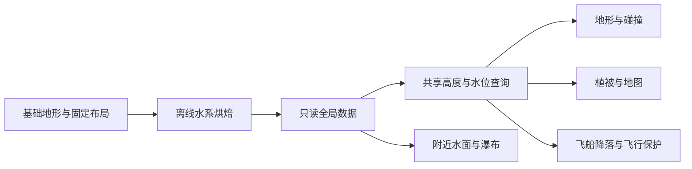
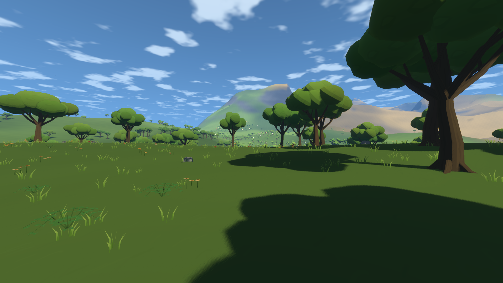
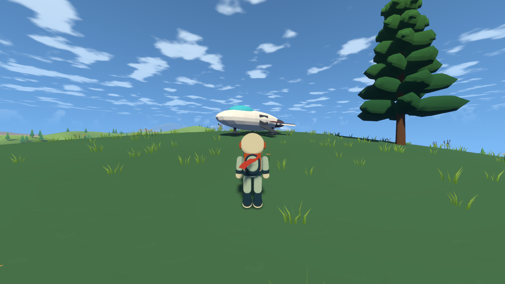
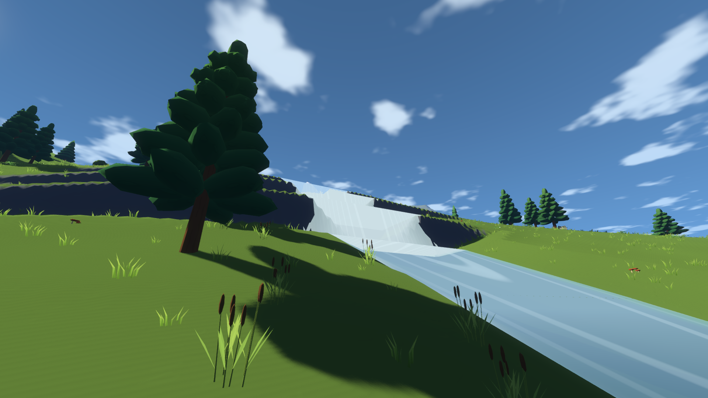

# 远行者第一大阶段验收记录

2026-10-20。按用户合并后的阶段划分，覆盖原第 0～3 步：基线、飞船与步行、全球水系、遗迹构件库。

## 范围与版本

文档基础为 Claude 分支的 `c71153b`。本地使用 `codex/wanderer` 开发，GitHub 的 `main` 尚未合并文档分支；没有把只读取旧 `main` 当成已阅读新方案。

本阶段新增内容集中在晨。飞船和渲染属于公共代码，但没有为烬、霜新增地貌、遗迹或玩法。用户明确验收范围后，自动验收默认改为 `dawn`，不再前往其他星球执行场景检查。最初的全项目基线仍保留，不能据此把后续阶段的星球推广写成已经完成。

## 交付内容

| 内容 | 当前行为 | 实现记录 |
| --- | --- | --- |
| 飞船 | 开局停放、登船、低空低速降落、远处长按召唤、第三人称驾驶、碰撞与存档 | [飞船与步行](飞船与步行记录.md) |
| 水系 | 晨的离线全球河湖、瀑布、峡谷，共享高度查询与分块水面 | [全球水系](全球水系记录.md) |
| 模型 | 飞船与 72 个遗迹构件，Blender 和程序化备用网格共用几何数据 | [遗迹构件](遗迹构件记录.md) |
| 声音 | 引擎、落地、舱门、瀑布四种分层合成音效，实际飞船混音检查 | [音频来源与边界](../game/audio/制作说明.md) |

Blender 使用官方 4.5.9 LTS 便携完整版，运行游戏不需要安装 Blender。模型可重复生成，模型文件和备用数据均随项目提供。



## 用户追加的画面修正

晨每个近景植被块的石块候选点由 19 个减为 5 个，其中稍大石块由 5 个减为 1 个；小石块缩放改为 0.2～0.65，较大石块改为 0.75～1.1，出发地的石块避让半径扩大到 32 米。树木与岩石的真实碰撞检查继续保留。

地表附近的小亮点先按边缘闪烁处理：保留原来的 2× MSAA，增加 FXAA。固定阔叶林机位、静止相机下各取六帧，以画面下半部的孤立高亮像素为指标，平均数量由 512.3 降到 232.8；相邻帧亮点变化由平均 154.6 降到 76.6。原图和统计位于 `test-output/wanderer/visual_*` 与 `visual_stability.json`。

这个结果说明该机位的孤立高亮和边缘变化减少，没有证明用户所见白点的全部成因。风动叶片、细小花叶和阴影边缘仍会发生像素变化；听感、运动中的观感与构件风格交由用户查看实际包确认。

阔叶林基线平均 13.10 ms，独立复测 12.64 ms，均超过 12.5 ms。为保留原预算，封闭树冠、树干和岩石改用背面剔除，薄草叶继续双面；地形云影改为顶点插值，并跳过贡献为零的火山、积雪和远景纹理计算。没有降低分辨率、渲染比例、地形网格或验收阈值。尝试过的云影格点纹理没有稳定收益，最终没有保留。

## 自动验收

最终汇总为 `passed: true`、`scope: dawn`，共 41 项自动检查全部通过。最后一次仅校正遗迹构件颜色，重新验证构件、包内资源、构件机位与启动；其他场景保留相同逻辑版本的检查结果。

```powershell
.\tools\Test-Acceptance.ps1 -Scope dawn
```

| 检查组 | 覆盖内容 |
| --- | --- |
| 8 项源码检查 | 水系、构件、飞船、生态生成、生态碰撞、相机、地表行走、完成度与存档 |
| 5 项发布包检查 | 模型与备用数据、核心交互、地图与视角、整球绕行与多地点着陆、实际环境音 |
| 25 个晨相关机位 | 原有晨机位及飞船、瀑布、峡谷、构件总览 |
| 3 项连续运行检查 | 60 秒降落、40 秒行走、正常启动 |
| 音频与打包核对 | 22 个素材、3 段飞船混音、音乐与环境混音；可执行文件、清单与压缩包哈希一致 |

打包资源检查曾报告空材质：临时飞船创建后同帧立即释放，早于渲染服务器完成新材质依赖更新。检查改为进入场景、经过实际渲染帧后再排队释放；修复后资源检查无错误。另补充 JSON 导出过滤，确保程序化备用网格与构件碰撞描述实际进入发布包。

所有本地报告位于 `test-output/acceptance/`。初始失败基线位于 `test-output/wanderer/baseline/`，中途失败日志保留，最终结果以本轮 `summary.json` 为准。

源码八项先完成；后续修复资源检查生命周期、验收数组类型和带速度的降落位移后，重测相关专项，再用重新导出的包执行完整发布包检查。最终汇总包含已完成的源码报告，并非把中途失败的一次命令写成整轮通过。

逐件展示进一步发现导出颜色通道错位导致的黑斑，已校正 GLB 中的 RGBA 并加入数值检查。几何、碰撞和其他运行逻辑未改变，因此最后一包只重测受影响的构件检查、模型加载、`s29_ruin_kit` 与正常启动，同时重新核对压缩包和可执行文件。

性能检查使用 Radeon 780M、1920 × 1080、渲染比例 1.0、关闭垂直同步；最终包为 2× MSAA 加 FXAA。固定机位要求平均不超过 12.5 ms、P95 不超过 16 ms；连续降落另要求 P99 不超过 20 ms、前三秒后无超过 50 ms 的帧、地形上传低于 4 ms。

### 机位性能

全部 25 个机位达标。基线与最终包使用相同机位；水系、石块分布及抗锯齿配置有所变化，数值用于回归参考。

| 机位 | 基线平均 ms | 最终平均 ms | 最终 P95 ms |
| --- | ---: | ---: | ---: |
| `s1_space` | 5.15 | 5.03 | 5.54 |
| `s2_high` | 4.63 | 4.57 | 5.08 |
| `s3_ground_day` | 9.20 | 8.50 | 9.14 |
| `s4_ground_sunset` | 9.52 | 8.68 | 9.23 |
| `s5_ground_night` | 8.76 | 8.03 | 8.84 |
| `s6_shore` | 8.85 | 8.64 | 9.64 |
| `s9_woodland` | 11.62 | 10.51 | 11.22 |
| `s10_highland` | 6.69 | 6.34 | 6.97 |
| `s11_orbit` | 4.77 | 4.99 | 5.55 |
| `s12_ruin` | 8.52 | 8.10 | 8.67 |
| `s13_tree_detail` | 8.45 | 8.11 | 8.95 |
| `s14_third_person` | 9.92 | 9.36 | 10.43 |
| `s15_relief_map` | 9.74 | 9.15 | 10.13 |
| `s16_terrace` | 8.09 | 6.89 | 7.76 |
| `s17_valley` | 7.70 | 6.82 | 7.37 |
| `s18_meadow` | 9.30 | 8.92 | 9.98 |
| `s19_broadleaf` | 12.64 | 11.61 | 12.23 |
| `s20_wetland` | 10.94 | 10.52 | 11.39 |
| `s21_drygrass` | 9.17 | 8.80 | 10.23 |
| `s22_tundra` | 8.35 | 7.83 | 8.47 |
| `s23_ship_parked` | 新增 | 8.86 | 9.72 |
| `s24_ship_low` | 新增 | 8.48 | 9.24 |
| `s25_waterfall` | 新增 | 9.18 | 10.19 |
| `s28_canyon` | 新增 | 10.23 | 11.10 |
| `s29_ruin_kit` | 新增 | 9.36 | 10.50 |

### 连续运行与发布包

- 连续降落：平均 6.31 ms，P99 9.33 ms，最大地形上传 1.679 ms；前三秒后超过 50 ms 的帧为 0，最终距目标 0.0045 米。
- 连续行走：水平位移 160.07 米，最低离地误差 -0.00481 米；行走与正常启动均通过。
- 晨完成三条整球绕行、六处着陆；实际环境音、音乐和飞船混音均通过技术检查。
- Windows 可执行文件大小 114.18 MiB，压缩包 45.16 MiB。可执行文件、清单与压缩包中的文件哈希一致。

最终可执行文件 SHA256：

```text
9961FE62347CA337E1578DA4A0532308D7F594BD06B19CA3DB0D3E738A3ACB22
```

## 展示

减少石块后的阔叶林：



飞船停放与探索者：



瀑布与河道：



72 个构件的固定机位总览：


同一套游戏材质的逐件展示，使用独立中性光照并关闭投影；每件按自身包围盒取景，图中相对大小不代表世界尺寸：


## 交付边界

本阶段提供构件库和摆放工具；古城、烽火塔链、洞穴、天梯、回声表演属于后续阶段，尚未建设。构件总览只在验收机位创建，正常旅程没有悬空展台。

两条模型路线共用 Blender 导出的几何数据，GDScript 负责在没有 glb 时重建，而非维护两套独立造型算法。洞穴和文明区尚无运行时查询，相关禁止降落与召唤条件待系统接入后补入公共查询。

按原交接文档第 3 步，构件总览需要用户确认风格；本次不进入原第 4 步。按用户要求，`refer/音乐/` 的 27 首参考音乐随本阶段提交；参考音乐没有复制到游戏或发布包。`output/` 保持本地状态，没有加入提交。
