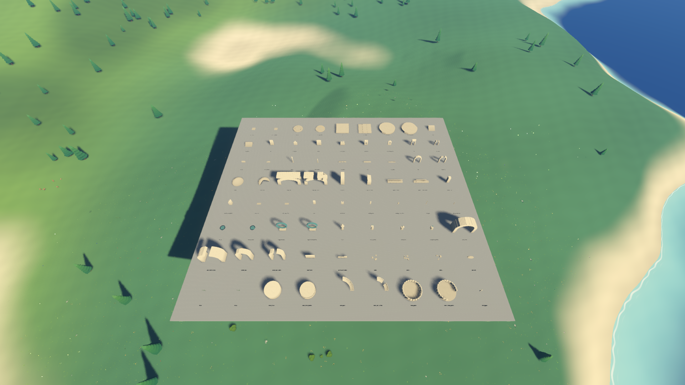
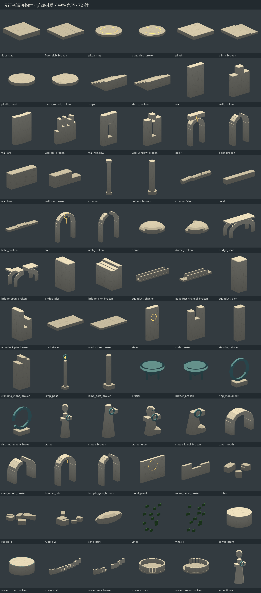

# 远行者遗迹构件库

2026-10-20。对应「远行者」原第 3 步。总体验收见[第一阶段验收记录](远行者第一阶段验收记录.md)。

## 内容

完成地面、台基、墙、门窗、柱梁、穹顶、桥、水渠、石碑、灯柱、火盆、环形纪念物、雕像、洞口、神殿门、壁画、碎石、积土、藤蔓和塔构件，共 72 个模型，包含残破变体。回声人影保留头部、长袍和双臂节点，供后续动作系统驱动。

```powershell
.\tools\Build-Models.ps1 -Target ruins
```

Blender 脚本生成 glb，并导出同源三角形数据；没有 Blender 或 glb 时，GDScript 根据这些数据建立网格。两条路线共用命名、尺寸、朝向、原点、材质和碰撞描述，运行游戏不依赖 Blender。备用网格不是独立手写的第二套形状算法，这是为避免两套模型逐渐偏离而作的实现调整。

## 材质与碰撞

- 石材、铜锈、光纹和布料共用遗迹着色器；包含近景笔触、裂纹、苔色、积土、湿润、云影和晨雾。规格颜色转换为线性空间后参与光照。
- 完好与残破构件保持一致的基准位置，断面用不同高度的石块表现。藤蔓使用绿色布料变体，不随风摆动。
- glb 使用 `-colonly`／`-convcolonly` 导出简化碰撞，程序化路线读取对应形状描述。门洞保持实际通行空间，台阶和盘旋石阶使用坡面碰撞；穹顶保留内外壳，环形纪念物保留环内空洞。
- `RuinBuilder` 按约 128 米格子和构件种类组织 MultiMesh，四个自定义通道保存风化与唤醒参数；近处 150 米建立碰撞，离开 200 米释放。小件关闭投影，按尺寸设置可见距离。

## 验证与展示

`ruin_kit_checks.gd` 检查清单模型、面数、尺寸、原点、两条路线包围盒、glb 与程序化碰撞数量，以及门洞净空。最大模型 1760 个三角形，其余按规格对应的小件、中件、大件和雕像预算检查。

逐件渲染曾发现部分表面出现黑斑，检查导出文件确认 `COLOR_0` 的 RGBA 数值错位，部分环境遮蔽值和透明度为零。生成脚本现在按最终顶点位置重写颜色通道；自动检查增加颜色语义校验，修正后的柱体和穹顶已逐件确认。问题定位到导出结果，尚未进一步确认底层打包错位的原因。

机位 `s29_ruin_kit` 生成带标签的构件总览，只有验收机位会创建展台，正常游戏不出现。固定机位原图位于 `test-output/acceptance/release/shots/s29_ruin_kit.png`，文档保留一份总览：



## 范围边界

本阶段只交付构件和摆放工具，没有建设古城、烽火塔链、洞穴或天梯，也没有接入回声表演。自动检查能确认几何与运行约束，构件是否符合期望风格仍需用户查看总览；进入第二大阶段前保留这一确认边界。


同一套游戏材质的逐件展示，使用独立中性光照并关闭投影；每件按自身包围盒取景，图中相对大小不代表世界尺寸：


